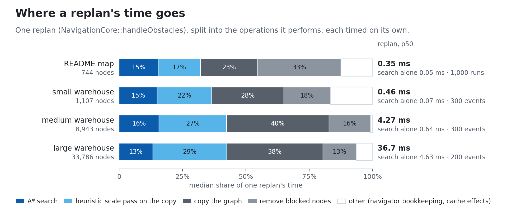
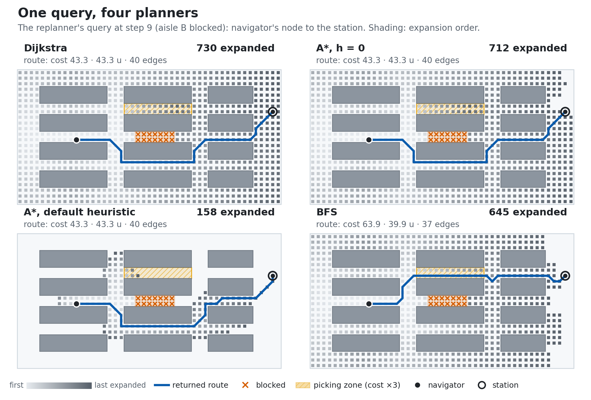
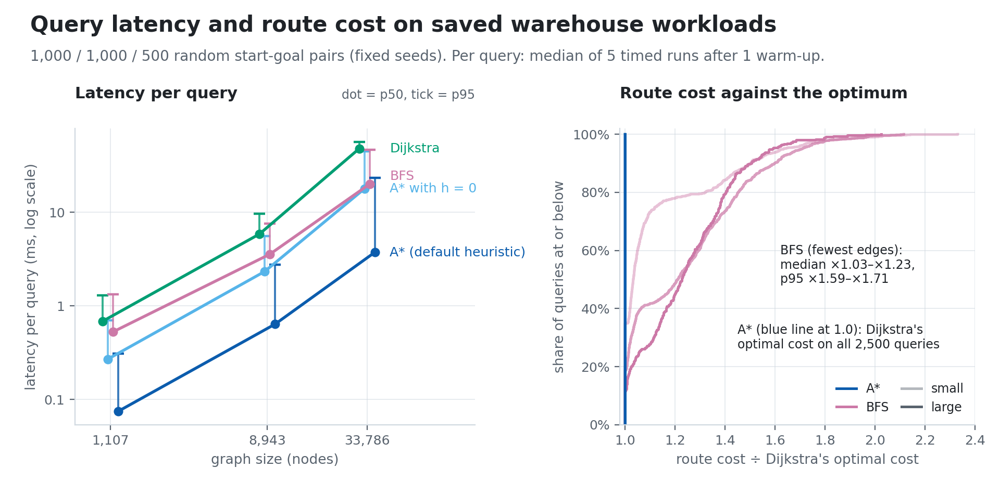

# Autonomous Navigation Engine

[](https://github.com/easensoy/autonomous-navigation-engine/actions/workflows/ci.yml)

A C++17 library that plans least-cost routes on weighted 2-D graphs, follows them one node per step,
and replans from its current node when nodes ahead are reported blocked. Below, it drives a simulated
robot in Gazebo through ROS 2, then runs on its own on a warehouse graph. Both animations are
regenerated from recorded runs, and CI recomputes the routes and checks the headline numbers against the
data in [`docs/data`](docs/data) and [`ros2/evidence`](ros2/evidence/README.md).


<sub><b>Closed-loop warehouse navigation, simulated in Gazebo Harmonic with ROS 2 Jazzy:</b> lidar-detected
node blockages, A\* replanning and differential-drive route execution.<br>
[Full recording](ros2/evidence/media/simulation-mission.mp4) · [Failure scenario](#failure-scenario-no-route-left) ·
[Experimental methodology](ros2/README.md#experimental-methodology)</sub>

<picture>
  <source media="(prefers-color-scheme: dark)" srcset="docs/assets/hero-dark.gif">
  
</picture>

<sub><b>The planner alone</b> on a 744-node warehouse graph, one node per step; no vehicle model.
Static frames: [light](docs/assets/hero-static-light.png) · [dark](docs/assets/hero-static-dark.png).</sub>

## What the animations show

**In simulation (scenario B, one recorded trial).** The robot follows the engine's route from the
dispatch station into the middle aisle. The scenario script inserts a pallet ahead of it without
notifying the navigator. 0.23 s after the pallet appears, lidar returns that the static map does not
explain mark three roadmap nodes blocked, and `handleObstacles` replaces the route ahead in 0.12 ms:
through the south aisle, because the north aisle's picking zone costs more. The robot returns to the
last node it reached, follows the detour and stops 0.05 m from the goal. The telemetry panel is the
navigator's recorded status at the same simulation time.

**On the graph.**

- **The map is a graph.** One node per free lattice point of a 47 × 24 warehouse: 744 nodes and 2,249
  two-way edges, diagonals included. An edge costs its length in coordinate units (u), times 3 inside
  aisle C's picking zone (a scenario assumption, not measured traffic). `NavigationCore` plans dock →
  station with A\* (through `DynamicReplanner`): cost 46.7 along aisle B.
- **Step 9: aisle B is blocked.** The caller reports 14 nodes of aisle B, 11 nodes ahead, through
  `handleObstacles`. The replanner searches from the navigator's current node on a copy of the graph
  without those nodes.
- **The decision.** It drops to aisle A and comes back up: remaining cost 43.3, against 37.7 for the
  abandoned remainder. The shortest detour by distance is 38.2 u, 5.1 u shorter, but it crosses the
  picking zone and would cost 62.2. The navigator arrives after 49 steps, having paid 52.3.
- **Verified against the graph.** The exporter checks that every step follows an edge, that no blocked
  node is entered after step 9, that the travelled part is kept, and that the replanned remainder costs
  exactly Dijkstra's optimum on the same reduced graph (20 checks, all passing). Planning took 0.12 ms
  and the replan 0.35 ms, median of 1,000 runs, timed apart from the animation.

### Finding: the search is the small part of a replan

<picture>
  <source media="(prefers-color-scheme: dark)" srcset="docs/assets/replan-cost-dark.png">
  
</picture>

**Tested:** `NavigationCore::handleObstacles` on 300, 300 and 200 random blockages (3 × 3 nodes on the
planned route) in three saved warehouses, and the hero's own replan 1,000 times; then each operation it
performs, timed separately. Nothing on this path prints, and the separately timed parts account for
85–97% of the end-to-end time (median per warehouse). **Result:** the A\* search is 13–16% of a replan
at every size. The rest is copying the whole graph, deleting each blocked node with a scan of every
adjacency list, and recomputing A\*'s heuristic scale over every edge of the copy, because a new
`AStar` cannot reuse the original's cache. On the 33,786-node warehouse that is 36.7 ms per replan
against 4.63 ms of search. **Conclusion:** on these graphs, replanning cost is dominated by graph
handling, not by the search; the search share stayed within 12–18% in all 4 runs recorded so far, while
absolute times moved with machine load. Filtering blocked nodes inside the search and reusing the
original A\*'s scale, which stays admissible when nodes are removed, would remove most of the rest;
that change is [proposed, not made](docs/TECHNICAL_NOTES.md#where-a-replans-time-goes).

## Robotics simulation validation

A ROS 2 Jazzy adapter ([`ros2/`](ros2/README.md)) runs `NavigationCore` in closed loop with a simulated
differential-drive robot in Gazebo Harmonic. The engine plans and replans; the adapter, outside the
library, associates poses with roadmap nodes, executes routes and maps lidar returns to blocked nodes;
Gazebo simulates physics, actuation and the lidar. Assumptions and untested conditions:
[Experimental scope](#experimental-scope).

<picture>
  <source media="(prefers-color-scheme: dark)" srcset="ros2/evidence/media/software-chain-dark.png">
  
</picture>

1. A scenario runner requests a mission. The adapter associates the robot's pose with the nearest
   roadmap node (within 0.20 m) and calls `NavigationCore::startNavigation`, which plans with A\* on an
   89-node roadmap generated from the same layout file as the Gazebo world.
2. The adapter executes the engine's node route edge by edge: it turns in place on nodes, tracks edges
   by pure pursuit with bounded speed and acceleration, and calls `executeNavigationStep` as each node is
   reached. At start-up it checks the roadmap against the robot's footprint (0.40 × 0.37 m): room to
   turn on every node, and to drive every edge with the largest tracking error the controller tolerates.
3. Gazebo's DiffDrive moves the robot, and the simulator's ground-truth pose closes the loop. Lidar
   returns that the static map does not explain mark roadmap nodes blocked, and `handleObstacles` keeps
   the route, replaces the part ahead, or enters `BLOCKED`.

### Results

Campaign `2026-11-09-eval`: 30 trials, six scenarios with five seeded trials each (initial-pose jitter,
lidar noise), each in a fresh container, judged against acceptance criteria fixed in the scenario files
before the first trial. 30 of 30 met every criterion. No trial collided: the smallest distance between
the robot's footprint and any obstacle was 0.41 m, and the robot never strayed more than 0.12 m from a
roadmap edge. Completed missions ended 0.016–0.053 m from the goal.

| Scenario | What happens | Result, 5 trials each |
|---|---|---|
| A. Nominal | dispatch → delivery through the middle aisle | completed |
| B. Aisle blockage | a pallet appears in the middle aisle ahead of the robot; nothing tells the navigator | blockage reported from the lidar 0.13–0.22 s after the pallet appeared, the same 5 nodes in every trial; the engine replaced the route in 0.12–0.22 ms (host); completed via the south aisle |
| C. Disconnection | an operator closes the two outer aisles; the pallet then blocks the middle one | engine `BLOCKED`; the robot stopped 0.53–0.57 s later and did not move again |
| D. Feedback dropout, 2 s | the pose feedback is withheld mid-aisle | zero velocity within 0.30 s of the loss, at most 0.28 m travelled without feedback; resumed and completed |
| E. Feedback loss, 6 s | longer than the 4 s recovery window | `FAILED_LOCALIZATION`; robot stopped |
| F. Drive stall | drive commands are replaced with zero | `FAILED_CONTROLLER` after 4.35–4.40 s (4 s progress timeout) |

<picture>
  <source media="(prefers-color-scheme: dark)" srcset="ros2/evidence/figures/simulation-trials-dark.png">
  
</picture>

Robot motion in every metric is the simulator's ground truth, not the navigator's report. Every engine
call that produced a route the robot followed (30 plans, 5 replacements, 5 `BLOCKED`) was planned again
offline by the engine from the same node, around the same blocked nodes, with identical results. CI
repeats that replay on every push, rebuilds the simulation image and runs scenario A once in headless
Gazebo; the badge shows the latest result. The engine calls are the A\* replans through
`DynamicReplanner` measured [above](#finding-the-search-is-the-small-part-of-a-replan).

### Failure scenario: no route left


<sub><b>Scenario C, simulated:</b> two operator closures (purple) leave only the middle aisle, the lidar
finds the pallet, and <code>handleObstacles</code> finds no route. The navigator enters
<code>BLOCKED</code> and commands zero velocity; the simulator's ground truth shows the robot standing still
0.58 s later and not moving again.<br>
[Full recording](ros2/evidence/media/simulation-failure.mp4) ·
[Experimental methodology](ros2/README.md#experimental-methodology)</sub>

Both recordings come from campaign `2026-11-09-capture` and are not among the 30 evaluated trials;
their captions and telemetry report their own values. Contracts, robot model, metrics and
reproduction: [ros2/README.md](ros2/README.md). Per-trial data: [ros2/evidence](ros2/evidence/README.md);
the rosbag2 recordings (307 MB) are not published, and [`recordings.json`](ros2/evidence/recordings.json)
lists each archive and bag with its size and SHA-256.

## Comparing planners

### Search behaviour and route quality on the replanner's query

<picture>
  <source media="(prefers-color-scheme: dark)" srcset="docs/assets/search-comparison-dark.png">
  
</picture>

**Tested:** the replanner's exact query at step 9, run through each planner with a `SearchObserver`
recording expansions in the order they happened. **Result:**

| Planner | Route cost | Length | Edges | Expanded |
|---|---:|---:|---:|---:|
| Dijkstra | 43.3 | 43.3 u | 40 | 730 (every reachable node; no early exit) |
| A\*, h = 0 | 43.3 | 43.3 u | 40 | 712 |
| A\*, default heuristic | 43.3 | 43.3 u | 40 | 158 |
| BFS | 63.9 | 39.9 u | 37 | 645 |

**Conclusion:** stopping at the goal alone saves little here (730 → 712, since the station is among the
farthest nodes); the heuristic does the work (712 → 158). BFS minimises edges, so it takes the picking
zone and pays 47.5% more. Attaching the observer leaves every route unchanged, which the exporter checks.

### A defect the traces exposed, now fixed

Recording expansions in order exposed a defect in A\*'s open list. Two equal-cost routes to a node can
sum to values one rounding step apart. Once the heuristic was added, both frontier entries had the same
*f*, the tie-break popped the stale one first, and the open list's bookkeeping then discarded the live
one, so the node was never expanded. On the saved workloads A\* returned a costlier route than
Dijkstra's on 15/1,000, 24/1,000 and 11/500 queries, by 0.51–1.41 cost units (at most 7.8%), and on a
five-node graph no route at all. The open list now keeps every entry, and the search alone skips stale
ones by comparing *g*. On the same workloads A\* now returns the optimal route cost on
all 2,500 queries and 800 replans, and two regression tests that failed on the old code pass.

Latency was measured separately, in a validation run that alternated the pre-fix and fixed builds:
A\*'s median query time fell by 11–17%, while the unchanged planners moved by at most 6%.
[Mechanism, traces and before/after data](docs/TECHNICAL_NOTES.md#a-tie-bug-found-by-the-traces).

### Query latency on fixed workloads

<picture>
  <source media="(prefers-color-scheme: dark)" srcset="docs/assets/perf-latency-dark.png">
  
</picture>

**Tested:** 1,000 / 1,000 / 500 seeded start–goal pairs on warehouses of 1,107, 8,943 and 33,786 nodes.
Each planner runs each query once as a warm-up and then 5 times timed; a query's latency is the median
of its 5. The four planners run back to back per query, in an order rotated by query and repetition;
one solver object is reused per graph, logging is silenced and no observer is attached.
**Result:** paired per query, A\* is 9.8–12.1× faster than Dijkstra at the median, and 3.2–4.2×
faster than A\* with *h* = 0, which isolates the heuristic's share. A\* returns Dijkstra's route cost
on every query. BFS returns a costlier route than the optimum on most queries (median cost
×1.03–×1.23); its times include its per-node print calls, which the API cannot disable.
**Conclusion:** on weighted warehouse graphs the scaled straight-line heuristic is what makes A\* fast,
and minimising edges is not a usable proxy for cost. Machine, background load and run-to-run
variation: [Experimental scope](#experimental-scope).

## Failure behaviour

<picture>
  <source media="(prefers-color-scheme: dark)" srcset="docs/assets/failure-panel-dark.png">
  
</picture>

**Tested:** the hero's trip with a different blockage at step 9: the goal itself, or both ends of the
goal's aisle. **Result:** the replanner returns no route, in the first case without searching and in
the second after A\* has expanded all 728 reachable nodes. The navigator enters
`NavigationState::BLOCKED`, whose contract is:

- `getCurrentPath()` returns only the travelled part, from the start to the current node;
- `getInvalidatedRoute()` returns the abandoned route ahead, kept for diagnosis, not as a plan;
- `executeNavigationStep()` returns `false` and the position does not change;
- `getRemainingDistance()` is infinite, and `getNavigationStatus()` starts with `BLOCKED`;
- recovery: `clearObstacles()` or `clearAllObstacles()` updates what the replanner knows, then
  `retryNavigation()` plans from the current node to the same goal; a new `startNavigation()` also
  replaces the blocked navigation. A retry while the blockage stands fails and changes nothing.

The exporter checks each item above in both scenarios, and `test_navigation_states` covers the
transitions, repeated failures and both recovery paths. `BLOCKED` is a state reported by a graph
planner: the library controls nothing physical, so it is not a safety function
([state table](docs/TECHNICAL_NOTES.md#navigation-states-and-failed-replanning)).

## Guarantees and their preconditions

A guarantee here is a property of the algorithm under the stated preconditions. The last column shows
how the implementation was checked; tests on finite samples are evidence, not proof.

| Component | Returns | Preconditions and behaviour | Checked by |
|---|---|---|---|
| `AStar` | A least-cost route, or an empty route if none exists | Non-negative weights; a negative weight throws `std::invalid_argument`. Default heuristic *k* · \|*n* − goal\|, with *k* the smallest cost per unit length over all edges: consistent for any non-negative weights ([proof](docs/TECHNICAL_NOTES.md#why-the-default-a-heuristic-is-safe)), recomputed when `Graph::getRevision()` changes. A custom heuristic must be admissible. The open list uses lazy deletion: stale entries are skipped by *g*, and a closed node is expanded again only when a strictly cheaper route reaches it | 20 cases, including 100 random graphs and 1,339 tie-heavy queries against Dijkstra; the 2,500 benchmark queries and 800 replans above |
| `Dijkstra` | Least-cost route; distances to every node | Non-negative weights; a negative weight throws. Settles every reachable node (no early exit) | 17 cases |
| `BFS` | Route with the fewest edges | Ignores weights, so not least cost | 15 cases |
| `BellmanFord` | Least-cost route with negative weights | Returns no route when it detects a negative cycle | 13 cases |
| `JumpPointSearch` | Least-cost route on a uniform-cost grid | One node per integer cell; edges exactly the orthogonal moves (weight *s*) and, if enabled, the diagonal moves whose two side cells hold nodes (weight *s*·√2); one *s* > 0; every edge in both directions. Any other graph throws `std::invalid_argument` naming the violation ([domain](docs/TECHNICAL_NOTES.md#jump-point-search-domain-rules-and-validation)) | 16 cases; 7,200 seeded queries on 600 grids (6,285 with a route) agree with Dijkstra on reachability and cost: a sample of the domain, not a proof |
| `NavigationCore` | An explicit `NavigationState`: `IDLE`, `ACTIVE`, `PAUSED`, `COMPLETED` or `BLOCKED` | A failed replan enters `BLOCKED` with the contract above; a failed start changes nothing | 12 cases in `test_navigation_states`; the exporter's failure checks |

Depth-first search returns some route, with no optimality guarantee, and throws for an unknown start or
goal where the other searches return an empty route.

## Experimental scope

**Robotics simulation.**

- **Execution:** Gazebo Harmonic and ROS 2 Jazzy on one host laptop, one Docker container per trial.
  Nothing has run on a physical robot or on a robot's onboard computer.
- **Pose:** the navigator receives the simulator's ground-truth pose; no localisation runs. Scenarios D
  and E test missing feedback, not wrong feedback; localisation error, drift and SLAM are untested.
- **Obstacles:** the pallet is inserted by the scenario script, and the navigator finds it only through
  its lidar; the aisle closures in C are operator notifications sent by the script. Both sources are
  recorded separately. The blockage mapper assumes an exact static map and box-shaped obstacles taller
  than the scan plane, and never clears a blockage on its own.
- **Motion layer:** one robot, a rotate-then-drive pure-pursuit controller, Gazebo's DiffDrive, a flat
  floor. Nav2 is not used, so there are no costmaps, local planner or recovery behaviours. The command
  gate and the halts are integration mechanisms, not safety functions.
- **Timing:** behaviour runs in simulation time. Wall-clock values are converted to host time, because
  the container's monotonic clock ran 5.6% fast. The host was shared with other work, and the
  simulation ran at 0.69–1.05 of real time.
- **What the trials establish:** in this warehouse, with this robot model, the engine's routes were
  executed without collision, a lidar-detected blockage led to the engine's replacement route, and the
  failure states halted the robot as specified, in five seeded trials per scenario. Real sensors,
  moving obstacles, other layouts, embedded timing and safety are untested.

**Benchmarks.**

- **Machine:** one laptop (Intel Core Ultra 7 165H, 22 logical processors, Windows 11, *Balanced* power
  plan) and one compiler (MSVC 19.51, `/O2`), shared with other work. Before timing, the benchmark
  waited for the CPU load to stay at or below 10% for two consecutive 10-second windows; in this run it
  waited the full 900 s without that happening (every window measured 20–51%) and then ran, as the
  protocol allows. While the timed commands ran, other processes used 16–24% of the machine's CPU
  capacity (`background_cpu_load` in each run record). No memory use is reported; Linux is built and
  tested only in CI, and macOS has not been tried.
- **Variation within the run:** a query's 5 timed repeats spread by 10–48% of their median (median over
  queries, per planner and size), which the per-query median damps. The 95th-percentile query takes
  1.1–6.0 times as long as the median one, most for A\*, whose work depends on the query, and least for
  Dijkstra, which settles every node. Ratios are paired per query, so a slowdown that hits all planners
  alike cancels out of them.
- **Variation between runs:** [`docs/data/history`](docs/data/history) keeps all 4 runs of this
  benchmark with their environment and results; the README shows the newest complete run at the
  published source, a rule declared before this run, and no run is dropped. Across them, Dijkstra ÷
  A\* ranged 9.4–13.0× (the first run predates the A\* fix), and the large warehouse's median replan
  30.4–44.9 ms ([protocol and noise](docs/EVIDENCE.md#measurement-protocol)).

**Library.** Graph planning only: no time, kinematics or vehicle model; obstacles are node ids the
caller reports; a step is one node.

## Known defects and proposed work

- **Known defects:** replanning copies the whole graph; `Node::euclideanDistance` scales coordinate
  distances by 0.1, so distances and edge weights can be in different units; most components print
  straight to standard output.
- **Proposed, not implemented:** replanning without copying the graph; timed trajectories inside the
  library (the simulation's controller follows node routes without a time parametrisation).

Everything else, including unreachable experimental classes: [docs/LIMITATIONS.md](docs/LIMITATIONS.md).

## Quick start

CMake 3.20+ and a C++17 compiler. On Windows, from the *x64 Native Tools Command Prompt for VS* (tested):

```bat
cmake -S . -B build -G Ninja -DCMAKE_BUILD_TYPE=Release -DCMAKE_CXX_COMPILER=cl
cmake --build build
ctest --test-dir build
build\AutonomousNavigationEngine.exe
```

On Linux, the commands the CI runs:

```bash
cmake -S . -B build -DCMAKE_BUILD_TYPE=Release
cmake --build build --parallel
ctest --test-dir build
./build/AutonomousNavigationEngine
```

Regenerate the figures and measurements on this page (9–12 minutes on the test machine, mostly the
benchmark, after up to 15 minutes of waiting for a quiet machine; `--skip-bench` re-renders from the
saved timings in about two minutes):

```bash
python -m pip install -r tools/evidence/requirements.txt
python tools/evidence/regenerate.py --cxx cl     # or --cxx g++ / clang++
```

Run it where CMake, Ninja and the compiler are on `PATH`; on Windows, the *x64 Native Tools Command
Prompt for VS* for MSVC. Per-toolchain commands are in [docs/TESTING.md](docs/TESTING.md).

## How it fits together

<picture>
  <source media="(prefers-color-scheme: dark)" srcset="docs/assets/how-it-fits-dark.png">
  
</picture>

The figures come from two C++ programs that link the library: `evidence_export` (trace mode: attaches
`SearchObserver`, checks every route, writes JSON) and `evidence_bench` (measurement mode: no observer,
raw timings to CSV). Python only summarises, draws and checks. A provenance manifest records the git
revision, uncommitted-change hash, compiler flags, machine and the hash of every output.

- **The traces are reproducible.** Rebuilt with GCC 14.2 on Windows, the exporter's traces matched
  MSVC's event for event; the CI rebuilds it on Ubuntu and requires the committed traces back exactly.
- **Tracing costs nothing when off.** With no observer attached, the hooks cost nothing measurable
  against the library as committed before them
  ([validation runs](docs/EVIDENCE.md#validation-runs-not-part-of-the-regeneration)).

Which figure comes from which file: [docs/EVIDENCE.md](docs/EVIDENCE.md#artifact-map).

## Tests and CI

- **15 CTest programs**, all passing with MSVC 19.51 and GCC 14.2 on Windows 11:
  - 12 functional programs with 152 cases, among them the A\* tie-bug regressions, the Jump Point
    Search corpus, the navigation states and the graph-operation API;
  - `test_api_link_coverage`, which takes the address of all 172 public member functions of the 15
    classes whose declarations were audited, so a declared but undefined member fails the build;
  - 2 benchmark smoke programs.
- **CI** (`.github/workflows/ci.yml`) runs seven jobs. Four build and test on Windows (MSVC, MSYS2 GCC)
  and Ubuntu 24.04 (GCC, Clang). The fifth, *Evidence checks*, needs only Python's standard library:
  `check_outputs.py` recomputes every exported route from the exported edge lists, re-reads the raw
  benchmark results and the run history, and requires the quoted numbers on this page;
  `test_check_outputs.py` corrupts the evidence six ways and requires the checker to fail each time;
  `compare_traces.py` rebuilds `evidence_export` and requires the committed traces back. CI never
  times anything.
- **ROS 2 integration in CI:** one job builds the ROS-independent adapter core and runs its unit and
  closed-loop tests, and replays the published simulation campaign through the engine. The other, the
  only simulator-dependent job, builds the simulation image, runs `colcon test` on the four ROS 2
  packages and one headless Gazebo trial ([details](ros2/README.md#tests-and-checks)).
- **More:** what the library contains, [docs/LIBRARY.md](docs/LIBRARY.md); design notes and findings
  in depth, [docs/TECHNICAL_NOTES.md](docs/TECHNICAL_NOTES.md); test inventory and toolchains,
  [docs/TESTING.md](docs/TESTING.md); API changes, [CHANGELOG.md](CHANGELOG.md).
