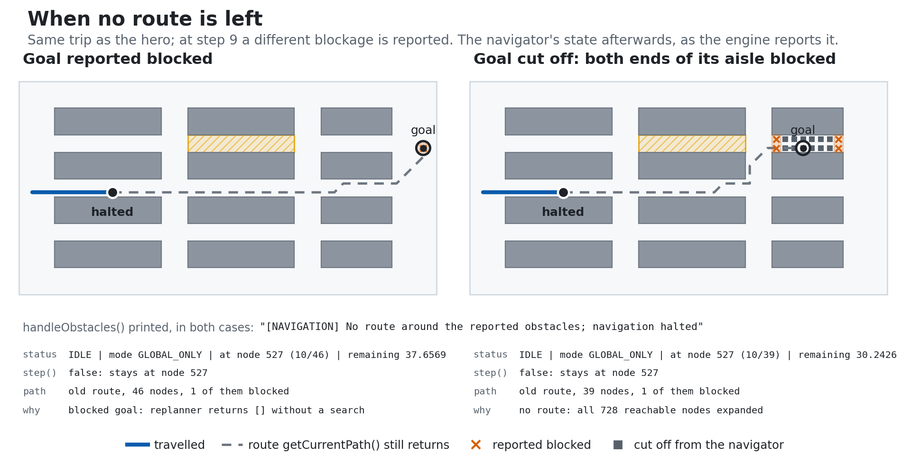

# Autonomous Navigation Engine

[](https://github.com/easensoy/autonomous-navigation-engine/actions/workflows/ci.yml)

A C++17 library that plans least-cost routes on weighted 2-D graphs, follows them one node per step,
and replans from the node it is on when nodes ahead are reported blocked. The figures and measured
numbers on this page are regenerated from the library's own output by one command; the scenarios,
ordered search traces and raw timings are in [`docs/data`](docs/data).

<picture>
  <source media="(prefers-color-scheme: dark)" srcset="docs/assets/hero-dark.gif">
  
</picture>

<sub>Simulated graph steps on a 744-node warehouse graph, one node per step; not a vehicle model.
Static version: [light](docs/assets/hero-static-light.png) · [dark](docs/assets/hero-static-dark.png).</sub>

## What happens

- **The map is a graph.** One node per free lattice point of a 47 × 24 warehouse: 744 nodes and 2,249
  two-way edges, diagonals included. An edge costs its length in coordinate units (u), times 3 inside
  aisle C's picking zone. `NavigationCore` plans dock → station with A\* (through `DynamicReplanner`):
  cost 46.7 along aisle B.
- **Step 9: aisle B is blocked.** The caller reports 14 nodes of aisle B, 11 nodes ahead, through
  `handleObstacles`. The replanner searches from the navigator's current node on a copy of the graph
  without those nodes.
- **The decision.** It drops to aisle A and comes back up: remaining cost 43.3, against 37.7 for the
  abandoned remainder. The shortest detour by distance is 38.2 u, 5.1 u shorter, but it crosses the
  picking zone and would cost 62.2. The navigator arrives after 49 steps, having paid 52.3.
- **Checked, not just drawn.** The exporter verifies the run against the graph: every step follows an
  edge, no blocked node is entered after step 9, the travelled part is kept, and the replanned
  remainder costs exactly Dijkstra's optimum on the same reduced graph (20 checks, all passing).
  Planning took 0.14 ms and the replan 0.42 ms, median of 1,000 runs, timed apart from the animation.

### Finding: the search is the small part of a replan

<picture>
  <source media="(prefers-color-scheme: dark)" srcset="docs/assets/replan-cost-dark.png">
  
</picture>

**Tested:** `NavigationCore::handleObstacles` on 300, 300 and 200 random blockages (3 × 3 nodes on the
planned route) in three saved warehouses, and the hero's own replan 1,000 times; then the operations it
performs, timed one by one. Nothing on this path prints to the console, and the separately timed parts
account for 86–98% of the end-to-end time (median per warehouse). **Result:** the A\* search is 14–16% of a replan at every size. The
rest is copying the whole graph, deleting each blocked node with a scan of every adjacency list, and
recomputing A\*'s heuristic scale over every edge of the copy, because a new `AStar` cannot reuse the
original's cache. On the 33,786-node warehouse that is 44.9 ms per replan against 5.94 ms of search.
**Conclusion:** replanning cost here is dominated by graph handling, not search. The search share
stayed within 12–18% across three full runs that day (the first before the A\* fix), while absolute
times moved with machine load.
Filtering blocked nodes inside the search and reusing the original A\*'s scale (still admissible when
nodes are removed) would remove most of it; that change is
[proposed, not made](docs/TECHNICAL_NOTES.md#where-a-replans-time-goes).

## Comparing planners

### Search behaviour and route quality on the replanner's query

<picture>
  <source media="(prefers-color-scheme: dark)" srcset="docs/assets/search-comparison-dark.png">
  
</picture>

**Tested:** the replanner's exact query at step 9, run through each planner with a `SearchObserver`
recording expansions in the order they happened. **Result:**

| Planner | Route cost | Length | Edges | Expanded |
|---|---:|---:|---:|---:|
| Dijkstra | 43.3 | 43.3 u | 40 | 730 (every reachable node; no early exit) |
| A\*, h = 0 | 43.3 | 43.3 u | 40 | 712 |
| A\*, default heuristic | 43.3 | 43.3 u | 40 | 158 |
| BFS | 63.9 | 39.9 u | 37 | 645 |

**Conclusion:** stopping at the goal alone saves little here (730 → 712, since the station is among the
farthest nodes); the heuristic does the work (712 → 158). BFS minimises edges, so it takes the picking
zone and pays 47.5% more. Attaching the observer leaves every route unchanged, which the exporter checks.

**A bug the traces found, now fixed.** Recording expansions in order exposed a defect in A\*'s open
list. Two equal-cost routes to a node can sum to values one rounding step apart. Once the heuristic was
added, both frontier entries had the same *f*, the tie-break popped the stale one first, and the open
list's bookkeeping then discarded the live one, so the node was never expanded. On the saved
workloads A\* returned a costlier route than Dijkstra's on 15/1,000, 24/1,000 and 11/500 queries, by
0.51–1.41 cost units (at most 7.8%), and on a five-node graph no route at all. The open list now keeps
every entry, and the search alone skips the stale ones. On the same workloads A\* now returns the
optimal route cost on all 2,500 queries and 800 replans, and two regression tests that failed on the
old code pass. That is a result about route cost. Latency was timed separately, in alternation with
the old code: queries got faster, not slower.
[Mechanism, traces and before/after data](docs/TECHNICAL_NOTES.md#a-tie-bug-found-by-the-traces).

### Controlled performance

<picture>
  <source media="(prefers-color-scheme: dark)" srcset="docs/assets/perf-latency-dark.png">
  
</picture>

**Tested:** 1,000 / 1,000 / 500 seeded start–goal pairs on warehouses of 1,107, 8,943 and 33,786 nodes;
each planner timed 5 times per query after a warm-up, one solver object reused per graph, logging
silenced, no observer attached. **Result:** paired per query, A\* is 10.0–13.0× faster than Dijkstra
at the median, and 3.2–4.3× faster than A\* with *h* = 0, which isolates the heuristic's share. BFS returns
a costlier route than the optimum on most queries (median cost ×1.03–×1.23). **Conclusion:** on weighted
warehouse graphs the scaled straight-line heuristic is what makes A\* fast, and minimising edges is not
a usable proxy for cost. **Qualifications:** absolute times are from one laptop and one compiler, and
this run shared the machine with background work: Dijkstra's and BFS's times, whose code did not
change, were 16–43% higher than in a quieter run earlier that day. In that run, before the A\* fix,
Dijkstra ÷ A\* was 9.4–10.6× ([protocol and noise](docs/EVIDENCE.md#measurement-mode-what-is-timed)).
BFS's times include its per-node print calls, which the API cannot disable.

### Failure behaviour

<picture>
  <source media="(prefers-color-scheme: dark)" srcset="docs/assets/failure-panel-dark.png">
  
</picture>

**Tested:** the hero's trip with a different blockage at step 9: the goal itself, or both ends of the
goal's aisle. **Result:** the replanner returns no route (in the first case without searching; in the
second, after A\* has expanded all 728 reachable nodes), the navigator prints a halt message, stays on
its node and refuses further steps. **Conclusion:** it fails
safe, taking no step once no route is left, but it reports `IDLE`, the same status as before a start,
while `getCurrentPath()` still returns the old route through the blocked nodes. Callers must read the
status, not the path.

## Quick start

CMake 3.20+ and a C++17 compiler. On Windows, from the *x64 Native Tools Command Prompt for VS* (tested):

```bat
cmake -S . -B build -G Ninja -DCMAKE_BUILD_TYPE=Release -DCMAKE_CXX_COMPILER=cl
cmake --build build
ctest --test-dir build
build\AutonomousNavigationEngine.exe
```

On Linux, the commands the CI runs:

```bash
cmake -S . -B build -DCMAKE_BUILD_TYPE=Release
cmake --build build --parallel
ctest --test-dir build
./build/AutonomousNavigationEngine
```

Regenerate the figures and measurements on this page (9–12 minutes on the test machine, mostly the
benchmark; `--skip-bench` re-renders from the saved timings in about two minutes):

```bash
python -m pip install -r tools/evidence/requirements.txt
python tools/evidence/regenerate.py --cxx cl     # or --cxx g++ / clang++
```

Run it where CMake, Ninja and the compiler are on `PATH`; on Windows, the *x64 Native Tools Command
Prompt for VS* for MSVC. Per-toolchain commands are in [docs/TESTING.md](docs/TESTING.md).

## How it fits together

<picture>
  <source media="(prefers-color-scheme: dark)" srcset="docs/assets/how-it-fits-dark.png">
  
</picture>

The figures come from two C++ programs that link the library: `evidence_export` (trace mode: attaches
`SearchObserver`, checks every route, writes JSON) and `evidence_bench` (measurement mode: no observer,
raw timings to CSV). Python only summarises and draws. A provenance manifest records the git revision,
uncommitted-change hash, compiler flags, machine and the hash of every output.

Two cross-checks support the numbers:

- Rebuilt with GCC 14.2, the traces match MSVC's event for event.
- With no observer attached, the hooks cost nothing measurable against the library as committed
  before them ([validation runs](docs/EVIDENCE.md#validation-runs-not-part-of-the-regeneration)).

Which figure comes from which file: [docs/EVIDENCE.md](docs/EVIDENCE.md#artifact-map).

## Tests and platforms

- **12 CTest programs, 112 functional cases**, all passing with MSVC 19.51 and GCC 14.2 on Windows 11,
  including `test_search_observer` (tracing never changes a route; events arrive in execution order)
  and the two A\* tie-bug regression tests.
- **CI** (`.github/workflows/ci.yml`) builds and tests on Windows with MSVC and MSYS2 GCC, and on
  Ubuntu 24.04 with GCC and Clang; the badge at the top shows its latest result. Linux builds are
  tested only there, and macOS has not been tried.
- **What the library contains** (searches, navigation, path operations, the demo):
  [docs/LIBRARY.md](docs/LIBRARY.md). Design notes and the measured findings in depth:
  [docs/TECHNICAL_NOTES.md](docs/TECHNICAL_NOTES.md). Test inventory and toolchains:
  [docs/TESTING.md](docs/TESTING.md).

## Limitations

- **Graph planning only:** no time, kinematics or vehicle model; obstacles are node ids the caller
  reports; a step is one node. The picking-zone cost is an assumption of the scenario.
- **Known defects:** replanning copies the whole graph; the navigator's no-route state reads as
  `IDLE`; Jump Point Search is experimental and not always shortest.
- **Measurements** come from one laptop (Intel Core Ultra 7 165H, Windows 11, MSVC, Balanced power
  plan) under varying background load, and report no memory use.

Everything else, including declared-but-undefined methods, unreachable experimental classes and the
library's mixed distance scale: [docs/LIMITATIONS.md](docs/LIMITATIONS.md).
