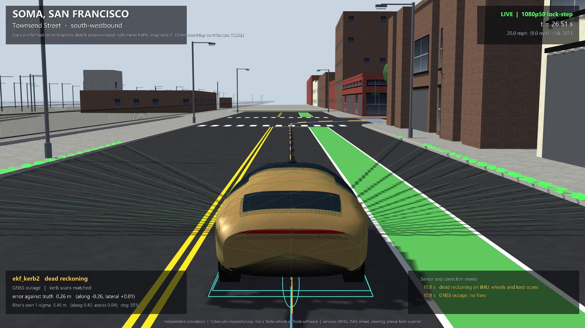

# road_driving

A first road-driving loop on top of the engine. A kinematic car follows lane-level routes from `Graph` and `NavigationCore` on small synthetic left-hand-traffic networks, and on reconstructed streets in London and in San Francisco, where traffic keeps right. The car is an approximately I-PACE-sized proxy by default, or a Cybercab-inspired proxy (`--vehicle cybercab_proxy_v1`). When an oracle reports a roadworks closure, the car reroutes from where it actually is or stops before the barrier.

It can drive on simulator truth (the reference) or on its own state estimate. Simulated GNSS, IMU, wheel, steering and kerb-ranging sensors feed one of five EKF variants, and the stack drives on its output. It keeps a margin from the kerb that follows the estimate's uncertainty, and stops explicitly when no clear continuation exists. Every episode is logged and can be replayed from its manifest.

Labels:
- **SYNTHETIC_ROADS:** networks R1 to R7, no real street.
- **SOURCE_INFORMED_ROADS:** the district networks `KEN` and `KNB` ([London](#london-district-scenes)) and `SF-SOMA` ([San Francisco](#san-francisco-soma)): real streets reconstructed from OpenStreetMap, with approximated details.
- **ORACLE_CLOSURE:** the scenario tells the stack about the closure; nothing is sensed.
- **Pose source:** either **GROUND_TRUTH_POSE**, the simulator's truth, or **ESTIMATED_POSE**, an estimator fed by **SIMULATED_SENSORS**.

There is no other traffic, and no perception or prediction.


<sub><b>Kerb re-localisation under a slow GNSS excursion, in simulation:</b> on R3-B, seed 5, the GNSS offset grows at 0.25 m/s along a straight. Kerbs cannot see along-road error there. At the next turn the scans stop fitting the estimate. Within 0.5 s `ekf_kerb2` finds the pose they fit, re-localises (0.56 m to 0.01 m), and makes the receiver earn trust again. The car completes with the body on the road. The first version, replayed on the same sensor log, keeps rejecting the kerbs and drifts to 4.3 m. Independent research simulation on development data.<br>
[Localisation design and results](LOCALISATION.md) · [R4 protocol](benchmark/PROTOCOL_R4.md) · [Poster frame](docs/media/test-drive-relocalise-poster.png) · Earlier demonstrations: [a GNSS fault with kerbs](docs/media/test-drive-kerb.gif), [a GNSS outage](docs/media/test-drive.gif)</sub>

## Localisation in brief

Seven predeclared evaluations, each run once with frozen code on data held out of all tuning:

| Evaluation (held out) | Tested | Criteria passed | Failed |
|---|---|---|---|
| First (R2) | `ekf` against dead reckoning and two GNSS-only filters | 6 of 8 | multipath capture: a 6 m offset longer than the 10 s reset failed 8 of 210 runs |
| Second (R3) | `ekf`, `ekf_int` (GNSS integrity), `ekf_kerb` (integrity and kerb registration) | 8 of 10 | `ekf_int` under combined faults; a slow GNSS excursion dragging even `ekf_kerb` on one route |
| Third (R4) | those, plus `ekf_int2` (a way out of GNSS faults) and `ekf_kerb2` (kerb re-localisation) | 10 of 11 | one `ekf_kerb2` episode of 280 over a kerb, after a correct re-localisation mid-turn |
| Fourth (R5) | the stack's re-join after pose corrections, each filter driven with and without it | 4 of 6 | with GNSS-only filters, one more crossing episode in five cells and one completion fewer |
| Fifth (R6) | a re-join limited to map-verified corrections, each filter driven with and without it | 4 of 6 | `ekf_kerb` followed two wrong kerb matches into deeper crossings; one `ekf_kerb2` closure incursion, identical without the re-join |
| Sixth (R7) | a re-join limited to kerb matches that fit the map uniquely, each filter driven with and without it | 5 of 6 | one `ekf_kerb2` episode over a kerb that had stopped on the road without the re-join, after two correct corrections |
| Seventh (San Francisco: route SF-B and seeds 1 to 15) | the unchanged filters and stack on a right-hand-traffic district, with a second vehicle profile and a misplaced map segment | 6 of 6, and one reported | none crossed a kerb; reported: R7's along-road mechanism recurred, as 10 fallback stops for lateral error |

On R4, every estimator processed the same recorded logs: 210 drives under seven conditions, with new fault magnitudes and combinations and a kerb map error. The stack then drove 1,440 closed-loop episodes:
- **Recovery after drift:** under a gyro-bias step during multipath, `ekf_int` never left the fault (errors up to 70 m). `ekf_int2` left it in 29 of 30 runs, and its pooled 95th percentile was 4.80 m against 54.8 m.
- **Slow excursion:** `ekf_kerb2` failed no run and drove 40 of 40 episodes as the reference did, with no crossing (`ekf_kerb`: 1 failed run, 2 crossings). Its NEES was 2.0; the dragged first version's was 305.
- **Combined faults:** `ekf_kerb2`'s lateral 95th percentile was 0.045 m against 0.600 m, and it ended 39 of 40 episodes as the reference did (`ekf_kerb`: 35).
- **Kerb map error:** a kerb section 0.5 m from where the map has it triggered no re-localisation, and no run failed.
- **Elsewhere:** where nothing triggers them, the second versions equal the first, run for run.

What failed or remains:
- **The stack after a large pose correction (U9):** a correct 0.8 m re-localisation mid-turn left pure pursuit oscillating until the monitor's fallback stop. During that stop the body went 0.91 m over the kerb. The same weakness turned estimate corrections into 6 fallback stops under kerb faults, with no crossing.
  - *Addressed afterwards:* the stack now re-joins its path smoothly after a pose correction. Rerun on R4, now development data, `ekf_kerb2` crossed in none of 280 episodes, and the kerb-fault fallbacks fell from 6 to 2 ([details](LOCALISATION.md#after-the-third-evaluation-pose-corrections-in-the-stack-development)).
  - *Held out on R5 (fourth evaluation, 4 of 6 criteria):* that failure did not occur there. The kerb filters never crossed or made a fallback stop, with or without the re-join.
  - With GNSS-only filters, already metres wrong, the re-join changed which episodes crossed, in both directions. The net was one more crossing episode in five cells and one completion fewer ([details](LOCALISATION.md#fourth-evaluation-the-re-join-held-out-on-r5)).
  - A stack cannot tell a correction from a corruption by the jump alone.
  - *Held out on R6 (fifth evaluation, 4 of 6 criteria):* the stack re-joined only corrections the estimator verified against the map.
    - GNSS-only filters drove every pair identically.
    - Where kerbs returned to correct a dragged estimate, `ekf_kerb2` ended 26 of 40 episodes as the reference did instead of 16, with 12 fallback stops instead of 22.
    - But after long dead reckoning a kerb registration can lock onto the wrong kerb: `ekf_kerb` followed two such matches into deeper crossings ([details](LOCALISATION.md#fifth-evaluation-the-verified-re-join-held-out-on-r6)).
  - *Held out on R7 (sixth evaluation, 5 of 6 criteria):* the stack re-joined only kerb matches that fit the map uniquely.
    - Where kerbs returned after GNSS drift, `ekf_kerb2` ended 24 of 40 episodes as the reference did instead of 18, and 29 instead of 21 after a kerb map error.
    - Under a gyro fault the re-join followed no correction; the R6 version, on the same episodes, followed wrong matches into crossings up to 11.5 m deeper.
    - One episode crossed that had not: a correct correction let the car drive on with a 2.7 m along-road error, which the next turn made a 0.88 m crossing. Without the re-join, the monitor had stopped it ([details](LOCALISATION.md#sixth-evaluation-the-unique-re-join-held-out-on-r7)).
- **GNSS-only drift:** while GNSS is rightly excluded, nothing bounds dead reckoning. `ekf_int2` still exceeded 5 m in 20 of 30 gyro-fault runs, and in one the fault never ended.
- **Losing kerbs and GNSS together** stopped the kerb filters for clearance in every such episode, 34 of the 40 stops unwarranted.

Details, the earlier evaluations and the next improvement: [LOCALISATION.md](LOCALISATION.md#results). The San Francisco evidence: [`benchmark/sf/`](benchmark/sf/README.md).

## Live 3D viewer

[`viewer/`](viewer/README.md) runs this simulation live in a native Panda3D application. The backend, `road_drive live`, runs the episode loop that every headless run uses and streams each 10 ms tick. The viewer draws what it reports: the true car, the estimate the stack drives on, kerb returns, GNSS fixes and corrections. Faults and closures can be injected while the car drives, each at a recorded tick, and a saved session replays headlessly.


<sub><b>Demonstration C, the sixth evaluation's failure, run live:</b> R7-A, kerb faults, seed 7, `ekf_kerb2` with the unique re-join. A correct 1.23 m kerb correction left 2.7 m of along-road error that the kerbs could not see on the straight. In this right turn it becomes lateral error, and the body goes 0.88 m over the kerb, as in the evaluation. Independent research simulation: synthetic streets, and an I-PACE-sized proxy, not a Jaguar.<br>
[Viewer](viewer/README.md) · [Full recording (MP4, 79 s)](docs/media/viewer-demo-c.mp4) · [Asset provenance](viewer/ASSETS.md)</sub>

```powershell
powershell -ExecutionPolicy Bypass -File road_driving\viewer\launch.ps1 -Setup
```

```powershell
powershell -ExecutionPolicy Bypass -File road_driving\viewer\launch.ps1
```

The first command installs Panda3D in `road_driving\viewer\.venv`, once; the second starts demonstration C. The C++ builds do not need Python, and CI runs the viewer's tests without Panda3D or a display.

## London district scenes

Two district networks drive real London streets, built by the grids' rules from OpenStreetMap: **`KEN`**, Kensington Gore and Queen's Gate, and **`KNB`**, Brompton Road, Hans Road and Basil Street ([`include/road_driving/district.hpp`](include/road_driving/district.hpp)).

What they take from OpenStreetMap, and what is inferred:
- **Sourced:** junction positions, street names, adjacency, one-way rules and a turn restriction.
- **Inferred:** carriageway widths, kerbs, Queen's Gate's central reservation and the turning paths.

They are source-informed reconstructions with approximated details, not surveyed models. They are two separate patches, not one continuous route. The viewer draws them with OpenStreetMap's building outlines and modular facades ([provenance](viewer/districts/PROVENANCE.md)).

```powershell
powershell -ExecutionPolicy Bypass -File road_driving\viewer\launch.ps1 --demo K
```

```powershell
powershell -ExecutionPolicy Bypass -File road_driving\viewer\launch.ps1 --demo N
```

How a district network differs from a grid:
- Junctions meet at any angle, and each side of a street has its own kerb.
- A turning path is a clothoid-arc-clothoid on the two lanes' intersection, at the largest radius that fits.
- A patch edge closes the carriageway where a street carries on beyond the model. It bounds the road for clearance, but it is no kerb, so the scanner sees nothing on it.
- The kerb distance takes its sign from the nearest kerb point.

The grids keep their own code paths, and their results are unchanged.

The two routes, each driven by `ekf_kerb2` with the unique re-join:
- **`KEN-A`** (696 m): Kensington Gore westbound past the Royal Albert Hall, left into Queen's Gate, and right into Elvaston Place. Under `gnss_outage_ldn` (seed 1) the fixes stop for 24 s on Queen's Gate. The filter dead-reckons for 22 s on the IMU and wheels, keeps registering kerb scans, and the run completes with a position RMSE of 0.07 m.
- **`KNB-A`** (637 m): Brompton Road south-westbound past Harrods, left into Hans Road, left into Basil Street, and right into Hans Crescent. Under `multipath_ldn` (seed 1) the fixes are biased by about 6 m for 22 s on Brompton Road. The integrity monitor flags them within 0.2 s and excludes them for 23 s, and the run completes with a position RMSE of 0.10 m.

Neither run crosses a kerb. These conditions were chosen to show the system at work in these scenes; they are not an evaluation.

## San Francisco: SoMa

**`SF-SOMA`** drives real San Francisco streets with **right-hand traffic**: Townsend, 5th, Brannan, 4th and Bluxome Streets, by the Caltrain station at 4th and Townsend. It is built like the London districts, from a pinned OpenStreetMap extract ([provenance](viewer/districts/PROVENANCE.md#san-francisco-soma)):
- **Sourced:** junction positions, street names, 4th Street's one-way rule and its two recorded turn restrictions, and the kerbs of 4th Street's light-rail trackway.
- **Inferred:** widths, kerbs and turning paths, with one modelled lane for each direction of travel.

The traffic side is a district setting. Lanes keep right of the centre line, the left turn crosses the opposing lane and carries the larger turn penalty, and the stack bounds its clearance shift on the lane's left. London and R1 to R7 keep left-hand traffic, and their results reproduce exactly.

**Vehicle profiles.** `ipace_proxy_v1` is the default. `cybercab_proxy_v1` is a Cybercab-inspired proxy: a 2.75 m wheelbase, 4.20 m long, 1.93 m wide, with no exterior mirrors. Its GNSS antenna, IMU and kerb scanner sit 1.30, 1.10 and 3.55 m ahead of the rear axle; the simulated sensors and the estimators' lever arms both use these mounts. Its outer dimensions and sensor mounts are research assumptions, and it uses the simulated actuator limits of the I-PACE proxy ([`vehicle.hpp`](include/road_driving/vehicle.hpp)). It is not a Tesla vehicle and runs no Tesla software.

```powershell
powershell -ExecutionPolicy Bypass -File road_driving\viewer\launch.ps1 --demo SF
```

[](https://github.com/easensoy/autonomous-navigation-engine/releases/tag/viewer-sf-v1)

<sub><b>San Francisco in the live 3D viewer, 1920×1080 at 50 fps:</b> SF-A under `gnss_outage_sf`, seed 2, the seed the protocol's rule picks (the median closed-loop RMSE). During the outage the 95% ring stretches along the road (sigma 0.40 m along, 0.04 m across) while the kerbs hold the lateral error. At 5th Street the junction's kerbs bring the along-road sigma back to 0.05 m ([frame](docs/media/sf-showcase-junction.jpg)). Independent simulation: a Cybercab-inspired proxy, not a Tesla vehicle. Map data © OpenStreetMap contributors.<br>
[1080p50 MP4, 120 MB](https://github.com/easensoy/autonomous-navigation-engine/releases/download/viewer-sf-v1/ane-sf-showcase-1080p50.mp4) · [Release: metadata and map data](https://github.com/easensoy/autonomous-navigation-engine/releases/tag/viewer-sf-v1) · [Viewer](viewer/README.md#san-francisco-scene) · [Evaluation](benchmark/sf/README.md) · [Provenance](viewer/districts/PROVENANCE.md#san-francisco-soma)</sub>

**The seventh evaluation** ([protocol](benchmark/PROTOCOL_SF.md), [evidence](benchmark/sf/README.md)) drove the unchanged filters and stack on two routes, under four conditions, with 15 seeds, on each vehicle:
- **Outage:** after 190 m without fixes, `ekf_kerb2` was 0.027 m from the truth when they returned (median), against 4.75 m for dead reckoning. It completed every closed-loop episode.
- **Drift:** the kerbs held a drift's across-road part, and the monitor flagged it. They cannot see its along-road part on a straight. In 13 of 30 runs `ekf_kerb2` entered the turn 1.8 to 4.0 m along the road from the truth, and 10 of those closed-loop episodes ended in fallback stops for lateral error. R7's along-road mechanism recurred; these wider streets left at least 3.9 m of clearance.
- **Map error:** `ekf_kerb2` followed a 110 m segment misplaced 0.6 m in its map. 6 of 30 episodes ended in fallback stops, none over a kerb.
- **Vehicle transfer:** the I-PACE proxy, on its own logs, gave the same picture.

A first run was stopped unread when a provenance check found that the network continued 5th Street into the Caltrain rail yard. The network was corrected, and the protocol committed again before the run reported here ([details](benchmark/PROTOCOL_SF.md#a-first-run-stopped)).

## How the engine is used

| Concern | Mechanism |
|---|---|
| Graph | One engine node per lane segment (at most 20 m) and per turning movement (connector), with the same ids. One-way edges exist only for legal moves, so one-way streets, the banned turn and the absence of U-turns are missing nodes or edges |
| Cost | Time to traverse the element entered at 20 mph, plus 1 s for a left turn and 4 s for a right turn (right turns cross the opposing lane in left-hand traffic), plus a deterministic tie-break below 1 ms |
| Heuristic | Nodes sit at their element's end point, so no edge is shorter in a straight line than the arc it enters, and the engine's rescaled A* heuristic stays admissible |
| Routing and replanning | `startNavigation` for the first route; `handleObstacles` with the closed segments, which replans from the engine's current node; `clearObstacles` and then `startNavigation` from the element the car occupies, after a lift |
| Step rule | `executeNavigationStep` each time the rear axle enters the next route element; the adapter checks that the engine's position matches the car's element |
| Engine limits | Found in an audit of the engine on 16 November 2026. A closure on the node the engine occupies is ignored, so the stack checks the occupied element itself and stops. Graph construction prints one line per node and edge, so `std::cout` is redirected during every engine call (about 13.6 kB per episode). Coordinates are validated against the ±10,000-unit node bound. `Graph::isConnected`, which is not valid on one-way graphs, is not used |
| Boundary | Only `src/engine_router.cpp` includes engine headers. The build enforces this by clearing the inherited include path for this directory |

## The loop

| Part | File | What it does |
|---|---|---|
| Network R1 | `lane_network.*` | 3 by 3 grid of junctions at x = 0, 120, 240 m and y = 0, 80, 160 m. Two-way streets with one 3.0 m lane each way, each lane left of its centreline; a one-way eastbound middle street; no right turn from the northbound approach at J11; a 60 m cul-de-sac with no turning head. Turns are a 5 m clothoid, an arc (7.5 m radius left, 10 m right) and a 5 m clothoid. A validator checks the map's invariants |
| Network R2 | `lane_network.*` | Held out for the first localisation evaluation, development data for the second. 4 by 3 grid at x = 0, 90, 240, 350 m and y = 0, 70, 170 m, from the same generator. Two one-way streets, two banned turns, 16 m junction mouths, 14 m right-turn arcs, and two tight junctions with 4 m kerbs and 5.5 m left-turn arcs taken at 2.5 m/s. Its geometry was fixed with the static footprint check alone (`road_drive map R2`) |
| Network R3 | `lane_network.*` | Held out for the second evaluation, development data for the third. 4 by 4 grid at x = 0, 110, 200, 330 m and y = 0, 85, 190, 270 m, with R2's junction design: two one-way streets, two banned turns, two tight junctions and a 50 m cul-de-sac |
| Network R4 | `lane_network.*` | Held out for the third evaluation, development data for the fourth. 5 by 3 grid at x = 0, 80, 170, 260, 380 m and y = 0, 100, 180 m, with R2's junction design: two one-way streets, two banned turns, two tight junctions and a 40 m cul-de-sac |
| Network R5 | `lane_network.*` | Held out for the fourth evaluation. 3 by 5 grid at x = 0, 105, 230 m and y = 0, 75, 160, 235, 330 m, with R2's junction design: two one-way streets, two banned turns, two tight junctions and a 45 m cul-de-sac |
| Network R6 | `lane_network.*` | Held out for the fifth evaluation, development data for the sixth. 4 by 4 grid at x = 0, 85, 205, 300 m and y = 0, 110, 190, 300 m, with R2's junction design: two one-way streets, two banned turns, two tight junctions and a 45 m cul-de-sac |
| Network R7 (held out) | `lane_network.*` | 5 by 4 grid at x = 0, 90, 185, 270, 365 m and y = 0, 100, 195, 290 m, with R2's junction design: two one-way streets, two banned turns, two tight junctions and a 40 m cul-de-sac |
| Kerbs | `lane_network.*` | Every kerb as a line or a corner arc. Clearance is the exact distance to them, and a ray is intersected with them |
| Vehicle | `vehicle.*` | Kinematic bicycle about the rear axle. Wheelbase 2.99 m; steering up to 0.55 rad at 0.4 rad/s with a 0.2 s lag; 0.1 s command delay; 0.3 s longitudinal lag; braking up to 8 m/s²; no reverse |
| Sensors | `sensors.cpp` | GNSS at 10 Hz, IMU at 100 Hz, wheel speed and steering angle at 50 Hz, and a kerb-height range scanner at 10 Hz, each with its own latency, noise, bias and mounting. Sensor conditions add outages, multipath (constant, intermittent or slowly growing), wheel slip, IMU bias steps, delayed and dropped fixes, parked cars, kerb clutter, and a kerb section that is not where the map has it. The same seed gives the same noise in every condition |
| Estimators | `estimators.cpp` | `ekf`: a 9-state EKF (pose, speed, gyro and accelerometer biases, wheel scale, two GNSS error states) with gating, robust weighting, a rewind buffer for late measurements, and a 10 s reset. `ekf_int`: the same with GNSS integrity instead of the reset. `ekf_kerb`: `ekf_int` plus scan-to-map kerb registration. `ekf_int2` and `ekf_kerb2`: a confirmed way out of a GNSS fault, and kerb re-localisation when scans keep being rejected. Baselines: dead reckoning, a GNSS-only constant-velocity filter, and the latest fix held |
| Driving stack | `stack.*` | Engine routing, the closure executive, a speed envelope (20 mph, and curvature caps at 1.9 m/s² lateral), stop guidance, pure pursuit steering, a constraint monitor and a fallback stop. On estimated pose it adds a localisation policy that slows, stops and resumes on the estimate's covariance and age. A clearance layer keeps the footprint's margin to the kerb in line with that uncertainty: it shifts the path sideways or stops explicitly. When the estimate jumps, the controller re-joins the path smoothly instead of steering at the jump |
| World | `episode.cpp` | 100 Hz integration, the sensors and estimator in estimated mode, the oracle notification and lift, and the logs |
| Evaluator | `evaluator.cpp` | Outcome and metrics from the truth log, the scenario and the map only, including whole-vehicle clearance, crossing depth and lane association |
| Benchmark | `benchmark.cpp` | Open-loop scoring of every estimator on the same logs, closed-loop campaigns against the ground-truth reference, and the summaries in [`benchmark/`](benchmark) |

**The closure decision.** When closure X1 is reported, the stack sends its segments to `NavigationCore`, which replans from the element the car occupies. The stack accepts the new route only if the car can meet the new path's speed caps within 3.5 m/s², starting from its actual position and speed after a 0.4 s latency. Variant B1 otherwise masks that turning movement in the engine and asks again; variant B0 accepts, and the constraint monitor then stops the car. With no acceptable route the car keeps its lane and stops 2 m before the barrier. The stop is classed COMFORT (at most 2.0 m/s²), FIRM (at most 3.5 m/s²), EMERGENCY (full braking still stops short of the barrier) or UNAVOIDABLE.

**Stop guidance.** The braking command is the constant deceleration that stops at the target under the vehicle's own actuator model: the current acceleration holds for the command delay, then relaxes with the longitudinal lag. It is computed in closed form from the actual speed and acceleration, and recomputed at 50 Hz. A stop decided while the car is still accelerating out of a turn therefore needs no more braking than planned.

## Build, test, run

From the repository root. GCC (MSYS2 UCRT64, with `C:\msys64\ucrt64\bin` first on `PATH`):

```bash
cmake -S . -B build/road-gcc -G Ninja -DCMAKE_BUILD_TYPE=Release -DCMAKE_CXX_COMPILER=g++ -DBUILD_ROAD_DRIVING=ON
cmake --build build/road-gcc
ctest --test-dir build/road-gcc --output-on-failure
```

MSVC, from a shell where `vcvars64.bat` has run: the same commands with `-DCMAKE_CXX_COMPILER=cl` and `build/road-msvc`.

```bash
build/road-gcc/road_driving/road_drive list
build/road-gcc/road_driving/road_drive run c3_r30 --variant B1 --seed 2 --out out/c3_r30_s2
build/road-gcc/road_driving/road_drive replay out/c3_r30_s2
build/road-gcc/road_driving/road_drive suite --variant B0 --seeds 6
```

Localisation:
- `drive` drives on an estimator (`ekf`, `ekf_int`, `ekf_int2`, `ekf_kerb`, `ekf_kerb2`; `--feasibility off` gives the stack without the clearance layer; `--rejoin` chooses the response to a pose correction: `unique`, the default, re-joins only corrections whose kerb scan fits the map uniquely, `verified` every map-verified correction as evaluated on R6, `on` every jump as evaluated on R5, and `off` none);
- `localise` replays the logged sensors through every estimator without the simulator;
- `bench-loc` and `bench-closed` run the campaigns. The splits are `dev` (R1), `heldout` (the first evaluation, R2), `r2` (R2 as development data), `r3` (the second evaluation), `r3dev` (R3 as development data), `r4` (the third evaluation), `r5` (the fourth), `r6` (the fifth), `r7` (the sixth), and San Francisco's `sf-dev` (development), `sf` (the seventh) and `sf-ipace` (its vehicle transfer). `drive`, `live` and `map` take `--vehicle ipace_proxy_v1|cybercab_proxy_v1`. `bench-closed --scenario` runs some of a split's scenarios; `tools/merge_closed_loop.py` merges such parts into the files one process writes. Each split drives the stack it was evaluated with; `bench-closed --rejoin off|on|verified|unique` overrides the re-join.

```bash
build/road-gcc/road_driving/road_drive drive R3-B --condition gnss_ramp_r3 --estimator ekf_kerb2 --seed 5 --out out/demo
build/road-gcc/road_driving/road_drive localise out/demo --estimators ekf_kerb,ekf_kerb2
build/road-gcc/road_driving/road_drive bench-loc --split r4 --seeds 10 --out out/r4
build/road-gcc/road_driving/road_drive bench-closed --split r4 --seeds 10 --scenario R4-A --out out/r4-cl/R4-A
```

`live` is the server behind the [3D viewer](viewer/README.md), which starts it itself. It reads commands on standard input and writes JSON lines ([protocol](viewer/PROTOCOL.md)). With `--script FILE` it takes the commands, each with its tick, from a file, and ends with the episode. `session-replay` replays a session the viewer saved, without it:

```bash
build/road-gcc/road_driving/road_drive live --scenario R7-A --condition kerb_faults_r7 --estimator ekf_kerb2 --seed 7 --speed 0 --script /dev/null > out/live.jsonl
build/road-gcc/road_driving/road_drive session-replay road_driving/viewer/examples/sandbox_session.json
```

The test-drive animation is rendered from that episode (Python with matplotlib, numpy and Pillow). `--compare ekf_kerb` draws the first kerb filter replayed on the same log:

```bash
build/road-gcc/road_driving/road_drive map R3 --json out/r3.json
python road_driving/tools/render_demo.py --map out/r3.json --episode out/demo --out out/test-drive-relocalise.gif --poster out/test-drive-relocalise-poster.png --poster-time 50 --compare ekf_kerb
```

The default build (`BUILD_ROAD_DRIVING=OFF`) is unchanged. CI enables the option in all four build jobs (Windows MSVC, Windows MSYS2 GCC, Ubuntu GCC and Clang), so CTest runs the eight tests below on each. The Linux jobs also replay a stored sensor log through every estimator, and run the 3D viewer's Python tests without a display against the backend they built.

## Closure results on ground-truth pose

Measured on 16 November 2026 on one Windows 11 laptop, with GCC 14.2 (MSYS2 UCRT64) and MSVC 19.51, using the code in this directory. There are 16 scenarios, each run with 6 seeds and both variants: 192 episodes per compiler. Seed 0 is the nominal start; seeds 1 to 5 jitter the start by up to ±2 m along the lane, ±0.2 m across it and ±2°, and in C3 and C4 the notification distance by up to ±1 m. The start is in the eastbound lane 20 m east of J00 and the goal 60 m north of J21. X1 closes the east street's northbound lane with its barrier 40 m north of J20; after J10, the only legal continuation leads into it. Braking figures are measured while the car moves.

| Scenario | When X1 becomes known | Outcome | Measured |
|---|---|---|---|
| `c0_nominal` | never (no closure) | COMPLETED 12/12 | 50.1 to 50.4 s to goal; braking at most 1.86 m/s² |
| `c1_prior` | before departure | COMPLETED 12/12 | Detour left at J10, north to J12, west, south to J01, east along the one-way street, left at J21. For seed 0 this equals the independent search's best route under full knowledge |
| `c2_advance` | 60 m before J10 | COMPLETED 12/12 | Replans to the same detour |
| `c3_r80` … `c3_r20` | 80, 60, 45, 30, 20 m before the barrier | STOPPED_AT_CLOSURE 60/60 | COMFORT; 1.84 to 1.90 m from the barrier; braking at most 1.86 m/s² |
| `c3_r12` | 12 m before the barrier | STOPPED_AT_CLOSURE 12/12 | EMERGENCY; 2.85 to 4.87 m from the barrier; peak 7.91 m/s² |
| `c3_r6` | 6 m before the barrier | CLOSURE_INCURSION 12/12 | UNAVOIDABLE; up to 3.73 m past the barrier |
| `c4_d40`, `c4_d25`, `c4_d15` | 40, 25, 15 m before J10 | COMPLETED 36/36 | Replan to the detour. At 15 m the required deceleration sits at the comfort boundary, and braking peaks at 2.03 m/s² |
| `c4_d8` | 8 m before J10 | COMPLETED 12/12 | Firm replan; peak 3.37 m/s² |
| `c4_d3` | 3 m before J10 | B1: STOPPED_AT_CLOSURE 6/6; B0: STOPPED_EN_ROUTE 6/6 | B1 masks the left turn it cannot slow for and stops 1.84 to 1.90 m from the barrier. B0 accepts it and the monitor's fallback stop brakes at up to 7.93 m/s² |
| `c5_lift` | 45 m before the barrier; lifted 30 s after the car stops | COMPLETED 12/12 | Replans from the occupied element and completes in 87.7 to 88.6 s |

Across all 192 episodes:
- cross-track error is at most 0.162 m on links (this includes the start jitter of up to 0.2 m) and 0.063 m on connectors;
- lateral acceleration is at most 1.91 m/s², and speed is at most 0.06 m/s over the limit;
- there are no illegal moves and no off-lane samples.

GCC 14.2 and MSVC 19.51 produce byte-identical truth logs in all 192 episodes. The variants differ only in `c4_d3`.

CTest runs eight tests with the option on:

- **`road_driving_tests`** (288 checks):
  - map invariants, including a mirrored right-hand copy that must be rejected;
  - engine routes against an independent Dijkstra on 200 queries, with and without closures;
  - routes unchanged at 1 and 10 graph units per metre;
  - vehicle kinematics and limits, and path continuity;
  - nominal and random-mission driving;
  - stop classes and braking distances against a numerical model of the same physics;
  - the commitment branch at J10, the closure lifecycle and determinism;
  - replay from a written episode;
  - an evaluator check on a hand-written truth log.
- **`road_driving_localisation_tests`** (185 checks):
  - sensor rates, latencies, arrival order and noise spread; no fix inside an outage zone; no brake-hold reading at rest;
  - every estimator replayed from `sensors.csv` without the simulator, matching the live estimates to 1e-9 m;
  - late and out-of-order GNSS giving the same EKF as in-order processing;
  - on nominal runs, EKF accuracy, NEES, a positive-definite covariance and a lower RMSE than every baseline;
  - multipath rejection, heading wrap, outage drift and recovery, and identical results on re-evaluation;
  - driving on the EKF: the nominal mission completes with no lane-association error, and an estimate without a covariance stops the car;
  - R2's map invariants, footprint clearance, slow tight turns and legal benchmark routes;
  - exact kerbs: the old function's sign everywhere, never smaller inside, on its zero set, rays stopping at the first kerb;
  - the kerb scanner: 10 Hz, returns on the mapped kerb, exact through the log, and kerb faults leaving the other sensors unchanged;
  - the GNSS fault generators: the ramp grows without a jump; the intermittent offset switches;
  - integrity: a persistent clean 6 m offset never trusted; a legitimate drift recovered by re-anchoring, not by a timer;
  - kerb registration: lateral 95th percentile below 0.10 m with a consistent NEES, including through an outage;
  - the clearance layer: no crossing at R2-B's right-turn exit where the previous stack crossed, an explicit stop where no margin is left, no effect on ground truth;
  - R3's and R4's map invariants, exact footprint clearance, legal routes and defined conditions, and R4's closure lane on its route;
  - the kerb map error: only returns from the left kerb inside its zone change, and only outward;
  - the second versions: equal to the first on clean data, trace for trace; the persistent offset still never trusted; drift still recovered. On an R3 combined-fault drive `ekf_int2` leaves the fault and ends within 1 m, where `ekf_int` ends 28 m off. On an R3 slow-excursion drive `ekf_kerb2` re-localises and keeps its lateral 95th percentile below 0.2 m;
  - pose corrections: the verified re-join follows a mid-turn kerb re-localisation and completes on the road; re-joining every jump (as on R5) also avoids a fallback after GNSS corrections, which the verified re-join leaves to the monitor;
  - the re-join switch: off reproduces the recorded fallback over the kerb; on simulator truth no setting changes anything; a GNSS-only filter drives identically with the verified re-join and without any;
  - the unique re-join: on R6's gyro-fault drive (seed 9) the verified re-join follows `ekf_kerb`'s wrong kerb match and crosses deeper, while the unique re-join follows nothing and drives as without a re-join; it still follows correct re-localisations, mid-turn on R3 and after a kerb blackout on R6; it changes nothing for a GNSS-only filter or on simulator truth;
  - R5's, R6's and R7's map invariants, exact footprint clearance, legal routes, closure lanes and defined conditions, and the r7 split's pairing.
- **`road_driving_regression_replay`** replays the stored failing episode.
- **`road_driving_replay_detects_change`** swaps that episode's variant label and requires the replay to fail.
- **`road_driving_live_tests`** (23 checks): the live server for the 3D viewer. With no commands it equals the headless run, for four configurations. Pacing, pausing, stepping and observing only every 7th tick change nothing. Injected faults leave no fix or scan inside them, and an offset moves each fix by exactly itself. A recorded session replays to the live trace.
- **`road_driving_district_tests`** (31 checks): the district networks `KEN` and `KNB`.
  - Each validates, and keeps left-hand traffic.
  - The footprint with mirrors, driven exactly along every movement and lane segment, clears the kerb: by 0.17 m at the tightest, a right turn out of Queen's Gate.
  - The kerb distance's sign matches a point-in-polygon test at about 109,000 points.
  - Patch edges bound the road but give the scanner no return.
  - The one-way streets and the recorded turn restriction hold, with no U-turn through Queen's Gate's reservation.
  - Both routes are reachable and legal, and drive to completion, deterministically, on simulator truth and on `ekf_kerb2`'s estimate.
  - A parked-car condition is refused.
- **`road_driving_sf_tests`** (44 checks): the San Francisco network and the vehicle profiles.
  - Lanes run right of their carriageway's centre, a left-hand copy is rejected, the grids refuse right-hand traffic, and the turn across the opposing lane carries the larger penalty: left in San Francisco, right in London.
  - 5th and Townsend is a T-junction; 4th Street is one-way with its trackway as a reservation, and its two recorded turn restrictions hold. The local frame reproduces a geodesic length to 2 cm.
  - Both profiles' footprints clear every movement; the kerb distance's sign matches a point-in-polygon test; patch edges give the scanner no return; both routes are reachable and legal.
  - The profile reaches the episode, the sensors' mounts, the estimators' lever arms, the manifest, the live scene message and a saved session; an older manifest replays with the I-PACE proxy, and an unknown profile is refused.
  - The four conditions: one outage with no fix inside it, a drift held at 4 m without a jump, and a map error that changes no measurement while the vehicle's map has both kerbs of a 110 m stretch 0.6 m to the side. A London live smoke run equals the headless one.
- **`road_driving_session_replay`** replays a session recorded through the viewer ([`viewer/examples/sandbox_session.json`](viewer/examples/sandbox_session.json)): six operator commands, among them a closure and its reopening.

## Episode files and replay

`--out` writes four files:
- `manifest.txt`: inputs, labels, engine commit, toolchain, outcome, metrics and hashes;
- `truth.csv`: 50 Hz truth and commands;
- `events.csv`: world and stack events;
- `routes.csv`: every route adopted, with the reason.

With a sensor condition it also writes `sensors.csv`, every measurement in arrival order, kerb scans included. In estimated mode it writes `estimates.csv` as well: the estimate the stack drove on, with its covariance, GNSS integrity state, kerb-match state and the clearance layer's path shift.

The trace hash is FNV-1a over `truth.csv`. `road_drive replay <dir>` reruns the episode from its manifest and compares the outcome, the route decisions and the trace hash; it prints the first differing truth line when the traces differ. When the recording toolchain is used, all three must match. On another toolchain the trace hash is reported but not required, because floating-point results are not assumed identical across maths libraries.

`regression/c4_d3_B0` is the deliberate failing episode: variant B0, notified 3 m before J10, recorded with MSVC 19.51. It replays byte for byte with GCC 14.2.

## Experimental scope

- **Network and inputs.** The roads of R1 to R7 are synthetic. The district networks follow real streets but are reconstructions: widths, kerbs, parking, junction geometry and turning paths are inferred, minor side streets are left out, and Queen's Gate's and 4th Street's two carriageways are modelled about their midlines ([provenance](viewer/districts/PROVENANCE.md)). No signals or stop control are modelled. The one closure is reported by an oracle, and there is no other road user.
- **Pose and sensors.** Pose is ground truth unless a run is labelled ESTIMATED_POSE. The sensors are simulated from truth with simple error models: GNSS, IMU, wheel speed, steering angle, and a planar range scanner at kerb height. The scanner sees only kerbs and objects standing in the carriageway; there is no point cloud, camera, or processed lidar or camera data. The receiver does not detect multipath.
- **Map.** The estimators and the world share the same kerb map, except for a smooth modelled deviation of 0.03 m RMS and the tested map errors: on R4 a kerb section 0.5 m out, and in San Francisco a 110 m segment whose two kerbs are 0.6 m to one side in the vehicle's map. Roadworks and other changes to the world were not tested.
- **Vehicle model.** The kinematic model ignores tyre forces, so wheel slip exists only as a sensor error. The I-PACE parameters are a proxy built from published dimensions, not a model of the vehicle; the Cybercab-inspired proxy's outer dimensions and sensor mounts are research assumptions, and it uses the I-PACE proxy's simulated actuator limits. Nothing here was driven on a physical vehicle.
- **The 3D viewer.** It draws what the backend reports and senses nothing itself. The car is an original proxy with the simulated dimensions. Its roof rig, the buildings and the street furniture are decorative, and no simulated sensor sees them. In the district scenes the buildings stand on OpenStreetMap's outlines, at heights taken from their mapped storeys, and their facades show each building type's elements, not a survey of any building.
- **Tuning.** The controller was tuned on R1. The controller settings are a look-ahead of 2.0 m + 0.30 s × speed, a 0.1 s pose prediction, and a speed envelope planned at 1.6 m/s² with a 0.4 s preview.
  - The first EKF was tuned on R1, and R2 was held out ([protocol](benchmark/PROTOCOL.md)).
  - Integrity, kerb registration and the clearance layer were developed on R1 and R2, and R3 was held out ([protocol](benchmark/PROTOCOL_R3.md)).
  - Each held-out network ran once with the frozen code.
- **Comfort limits.** Jerk is not limited: braking onset reaches up to 26 m/s³ at an emergency stop. A replan whose required deceleration sits at the comfort boundary can peak slightly above 2.0 m/s² (2.03 measured).
- **Clearance.** Measured exactly against the kerbs of the synthetic map: no kerb height, verge or parked car. The tightest places are right-turn exits on R2 and R3, where the footprint with mirrors, driven exactly, clears the far kerb by 0.023 m; on R1 it crosses by 0.11 m. Earlier figures came from a conservative function and are corrected in [LOCALISATION.md](LOCALISATION.md#kerbs-and-clearance).
- **Engine commit.** The engine commit is recorded when the build is configured.
- **Deferred to later milestones:**
  - the disconnected-network class C6;
  - campaign tooling with paired summaries for the closure scenarios;
  - perception and prediction;
  - kerb registration against map errors larger than the modelled deviation, and lane markings.
