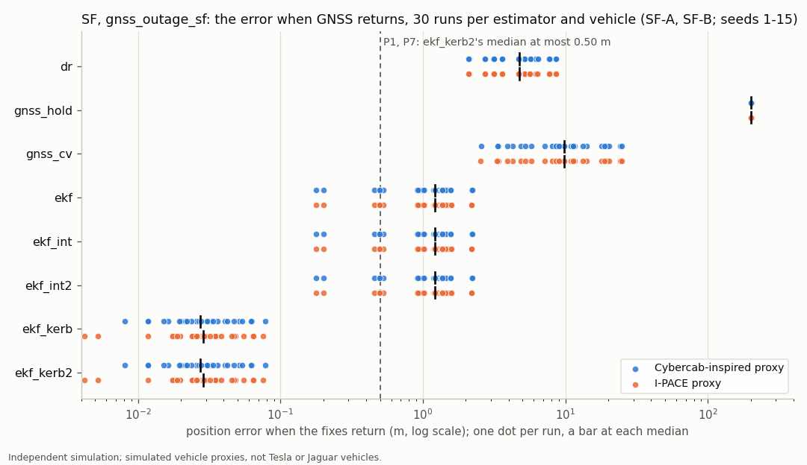
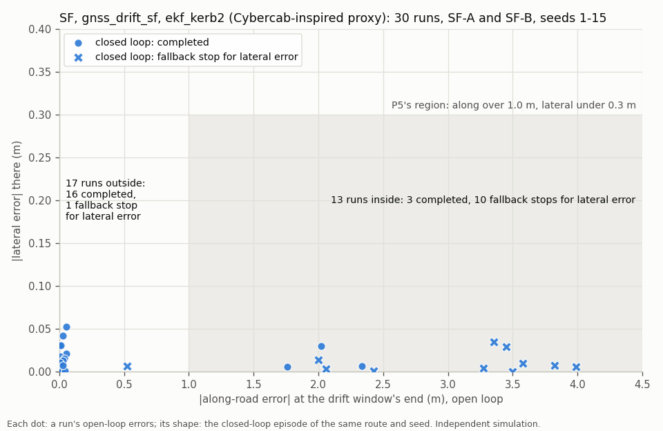
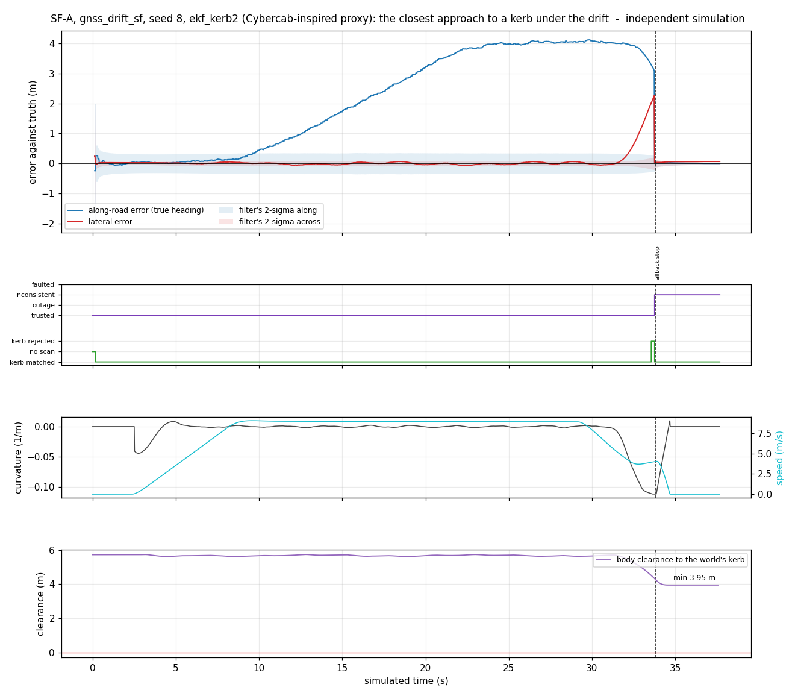

# San Francisco: the unchanged filters on a new network

The evidence for [`PROTOCOL_SF.md`](../PROTOCOL_SF.md): one run of the frozen evaluation, built with MSVC 19.51 (Release) at commit `5f2c004`, the commit that fixed the protocol. It ran on the `SF-SOMA` network (South of Market, right-hand traffic, [provenance](../../viewer/districts/PROVENANCE.md#san-francisco-soma)) with the Cybercab-inspired proxy, and on the same routes, conditions and seeds with the I-PACE proxy. No estimator or stack setting changed since R7. This is an independent simulation: neither proxy is a Tesla or a Jaguar vehicle, and no Tesla or Waymo software or data is used.



## Verdicts

| # | Question | Result | Verdict |
|---|---|---|---|
| P1 | Do kerbs carry the filter through a GNSS outage? | `ekf_kerb2` below dead reckoning in 30 of 30 pairs. Median error when GNSS returns: 0.027 m. Dead reckoning: 4.75 m. `ekf` and `ekf_int2`: 1.21 m. `gnss_cv`: 9.8 m | passed |
| P2 | Nominal accuracy and consistency | Worst run's 95th percentile 0.383 m (bound 0.50 m). Lateral 95th percentile at most 0.051 m (bound 0.10 m). No EKF run failed. Median NEES 1.40 for `ekf` and `ekf_int2`, 1.15 for `ekf_kerb2` | passed |
| P3 | Closed loop, nominal and outage | `ekf_kerb2` ended 30 of 30 episodes as the reference did, in each condition. No kerb crossing, no fallback stop | passed |
| P4 | A map error the scanner cannot reject | No `ekf_kerb2` episode over a kerb. 24 of 30 completed; 6 fallback stops for lateral error | passed |
| P5 | The R7-A seed 7 mechanism | 13 of 30 drift runs entered the turn with more than 1 m of along-road error and under 0.3 m lateral. 10 of those 13 closed-loop episodes ended in fallback stops for lateral error. None crossed a kerb | mechanism reproduced; no crossing |
| P6 | False alarms without faults | No FAULTED or INCONSISTENT entry in `nominal_sf` | passed |
| P7 | The vehicle transfer | On the I-PACE proxy's own logs: 30 of 30 pairs, median 0.029 m | passed |

The criteria, their inputs and every table are in [`criteria.md`](criteria.md) and [`summary.json`](summary.json), computed by [`tools/sf_analysis.py`](../../tools/sf_analysis.py). The full tables are [`sf/summary.md`](sf/summary.md) and [`sf/closed_loop.md`](sf/closed_loop.md), and the same files under [`sf-ipace/`](sf-ipace). Every run counts.

## What the results show

**Kerbs carry the outage.** The fixes stop for 190 m: the last 180 m of the first straight and the turn's entry. The kerb filters hold the lateral error throughout (the runs' 95th percentiles have a median of 0.042 m). When the fixes return, the estimate is 0.027 m from the truth (median). The filters without kerbs return at 1.21 m, dead reckoning at 4.75 m. In closed loop all 30 `ekf_int2` episodes stop for localisation inside the outage, and wait there, as the protocol expected. `ekf_kerb2` completes all 30.

**The kerbs of a straight cannot see along-road error.** The drift grows at 0.3 m/s to 4 m and holds there until the turn; its direction is drawn per seed. Its across-road part is contradicted by the kerbs. Its along-road part is invisible to them. In the 17 runs that reached the turn with less than 1 m of along-road error, the integrity monitor flagged the fixes (FAULTED or INCONSISTENT) 7.0 to 13.8 s after onset. In the other 13, `ekf_kerb2` entered the turn 1.76 to 3.99 m along the road from the truth. Over those drives its own 95% interval held only 55 to 71% of its along-road errors. Nine of the 13 were flagged inside the drift window (median 12.8 s after onset), with the along-road error already built up; the other four only 2.0 to 4.5 s after the window ended, at the turn. At the turn the along-road error becomes lateral: 10 of those 13 closed-loop episodes end in a fallback stop for lateral error at the first turn, with at least 3.94 m of clearance left. This is the R7-A seed 7 mechanism. SF's wide streets leave room, so here it ends in stops, not in R7's kerb crossing.



**A misplaced map segment is followed.** For 110 m during the outage, both kerbs in the vehicle's map lie 0.6 m to the right of the true kerbs, with a step at each end. `ekf_kerb2` follows the segment (median largest lateral error beside it: 0.644 m), as development predicted. It leaves the outage with a larger error than the filters without kerbs: 1.69 m against `ekf_int2`'s 1.21 m (median; `ekf_kerb2` lower in 10 of 30 pairs), nearly all of it along the road. In closed loop that error meets the same turn: 6 of 30 episodes end in fallback stops for lateral error, at the first turn, and none crosses a kerb. `ekf_int2` stops for localisation in all 30, as in the plain outage.

**The vehicle transfer holds.** The I-PACE proxy's sensors sit 0.29 to 0.30 m further forward. On its own logs P1's test gives 30 of 30 (median 0.029 m). In closed loop it completes 30 of 30 under nominal and outage, 20 of 30 under the drift and 22 of 30 under the map error. Seven of its eight map-error stops are for lateral error; the eighth is a planning stop (the monitor's message: "speed caps ahead need 5.08 m/s^2, above the firm limit").

### Closed loop

Episodes per cell: 30 (SF-A and SF-B, seeds 1 to 15). Clearance is the footprint's smallest distance to the world's kerb, with mirrors. Illegal transitions are moves of the true vehicle onto an element that is not a legal successor, which the evaluator counts from truth.

| Vehicle | Condition | Pose source | Completed | Fallback stops | Localisation stops | Over a kerb | Min clearance (m) | RMSE, median (m) | Illegal transitions |
|---|---|---|---|---|---|---|---|---|---|
| Cybercab-inspired | (reference) | ground truth | 30 | 0 | 0 | 0 | 4.32 | - | 0 |
| | `nominal_sf` | `ekf_kerb2` | 30 | 0 | 0 | 0 | 4.28 | 0.087 | 0 |
| | | `ekf_int2` | 30 | 0 | 0 | 0 | 4.15 | 0.182 | 0 |
| | `gnss_outage_sf` | `ekf_kerb2` | 30 | 0 | 0 | 0 | 4.28 | 0.158 | 0 |
| | | `ekf_int2` | 0 | 0 | 30 | 0 | 4.72 | 0.510 | 0 |
| | `gnss_drift_sf` | `ekf_kerb2` | 19 | 11 | 0 | 0 | 3.94 | 0.404 | 1 |
| | | `ekf_int2` | 27 | 3 | 0 | 0 | 1.51 | 2.005 | 36 |
| | `kerb_map_error_sf` | `ekf_kerb2` | 24 | 6 | 0 | 0 | 4.29 | 0.660 | 3 |
| | | `ekf_int2` | 0 | 0 | 30 | 0 | 4.72 | 0.510 | 0 |
| I-PACE proxy | (reference) | ground truth | 30 | 0 | 0 | 0 | 4.15 | - | 0 |
| | `nominal_sf` | `ekf_kerb2` | 30 | 0 | 0 | 0 | 4.11 | 0.087 | 0 |
| | `gnss_outage_sf` | `ekf_kerb2` | 30 | 0 | 0 | 0 | 4.11 | 0.158 | 0 |
| | `gnss_drift_sf` | `ekf_kerb2` | 20 | 10 | 0 | 0 | 3.83 | 0.407 | 1 |
| | `kerb_map_error_sf` | `ekf_kerb2` | 22 | 8 | 0 | 0 | 4.12 | 0.661 | 5 |

Without kerbs, `ekf_int2` follows the drift: it completes more drift episodes than `ekf_kerb2` (27 against 19), but with a median RMSE of 2.0 m, the smallest clearance of any cell (1.51 m) and 36 illegal transitions.

## Example runs

Each is a single drive (`road_drive drive ... --out`) that reproduces its campaign episode's trace hash exactly. Each has a timeline from [`tools/sf_timeline.py`](../../tools/sf_timeline.py): the error along and across the true heading against the filter's own 2-sigma, GNSS and kerb states, curvature and speed, and the body's clearance.

- **Typical:** [SF-A, `gnss_outage_sf`, seed 2](examples/sf-a_gnss_outage_sf_seed2.png). It is the seed the protocol's rule picks for the showcase: the median closed-loop RMSE of the 15 (0.160 m). The along-road error grows to 0.35 m inside its own band during the outage, and the turn's kerbs remove it. Completed, with 5.62 m of clearance.
- **Worst relevant:** [SF-A, `gnss_drift_sf`, seed 8](examples/sf-a_gnss_drift_sf_seed8.png). It came closest to a kerb under the drift. The along-road error reaches 4.1 m far outside the filter's band while GNSS stays trusted. At the turn it becomes 2.3 m of lateral error, and the stack makes a fallback stop at 33.8 s, with 3.95 m of clearance.



## Experimental scope

- **One district, simulated.** Two routes share the district's streets in opposite directions, with 15 seeds. There is no other traffic, and no signals or stop control. The network is a source-informed reconstruction from OpenStreetMap, not a survey.
- **The faults are prescribed models.** The outage, the drift and the misplaced map segment are placed in metres along each route. No building geometry generates them. The drift's direction is drawn per seed, so how many runs drift along the road is itself a random outcome.
- **The proxies are not the vehicles they are named after.** The Cybercab-inspired proxy takes its size from public figures; its sensor mounts and actuator limits are research assumptions ([`vehicle.hpp`](../../include/road_driving/vehicle.hpp)).
- **One toolchain is the reference.** MSVC and GCC produce different estimated-pose traces (floating point), and these results are MSVC's.
- **A first run was stopped.** It was stopped and set aside unread when a check found that the network continued 5th Street into the Caltrain rail yard. The network was corrected, development re-run and the protocol committed again before this run ([details](../PROTOCOL_SF.md#a-first-run-stopped)).

## Reproduce

From the repository root, with the MSVC build of `5f2c004`:

```bash
road_drive bench-loc --split sf --seeds 15 --out road_driving/benchmark/sf/sf
road_drive bench-closed --split sf --seeds 15 --out road_driving/benchmark/sf/sf
road_drive bench-loc --split sf-ipace --seeds 15 --out road_driving/benchmark/sf/sf-ipace
road_drive bench-closed --split sf-ipace --seeds 15 --out road_driving/benchmark/sf/sf-ipace
python road_driving/tools/sf_analysis.py road_driving/benchmark/sf
python road_driving/tools/sf_plots.py road_driving/benchmark/sf
road_drive drive SF-A --condition gnss_drift_sf --mode estimated --estimator ekf_kerb2 --rejoin unique --vehicle cybercab_proxy_v1 --seed 8 --out road_driving/benchmark/sf/examples/sf-a_gnss_drift_sf_seed8
python road_driving/tools/sf_timeline.py road_driving/benchmark/sf/examples/sf-a_gnss_drift_sf_seed8 road_driving/benchmark/sf/examples/sf-soma.scene.json OUT.png
```

The wall-clock fields (`runtime_ms_wall`, `latency_*_us_wall`, and the p99 latency column in `summary.md`) vary from run to run. A second run of the `sf` split on the same build reproduced every other field of its 960 runs and 270 episodes, trace hashes included, and `closed_loop.md` byte for byte.
