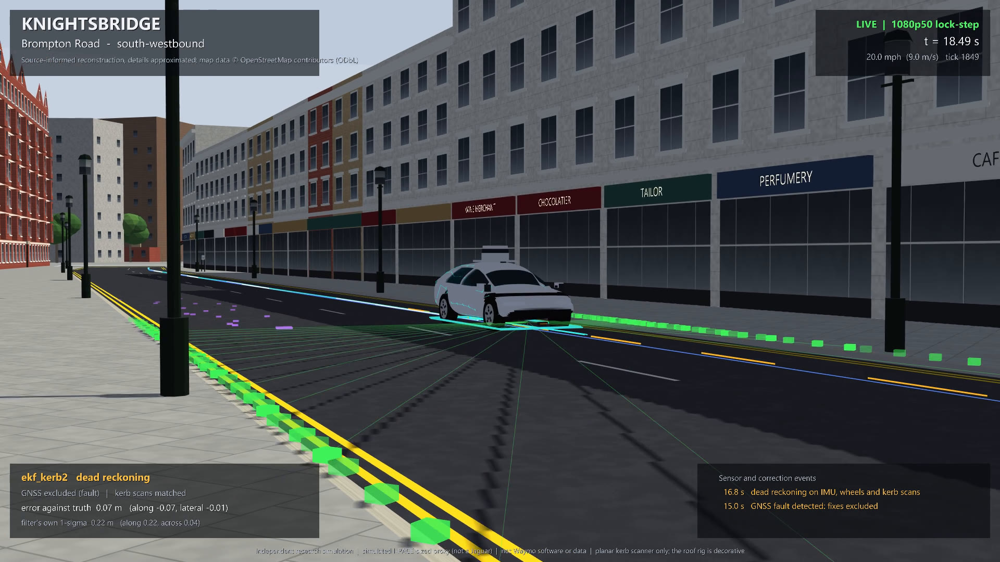
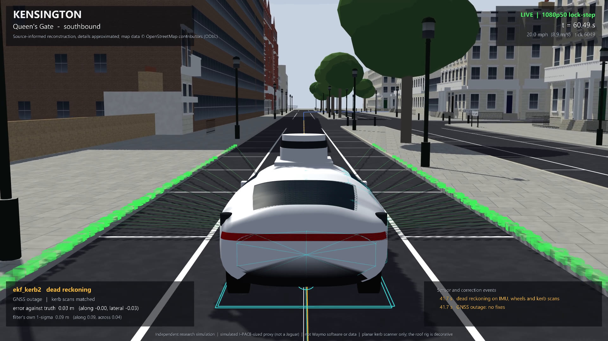
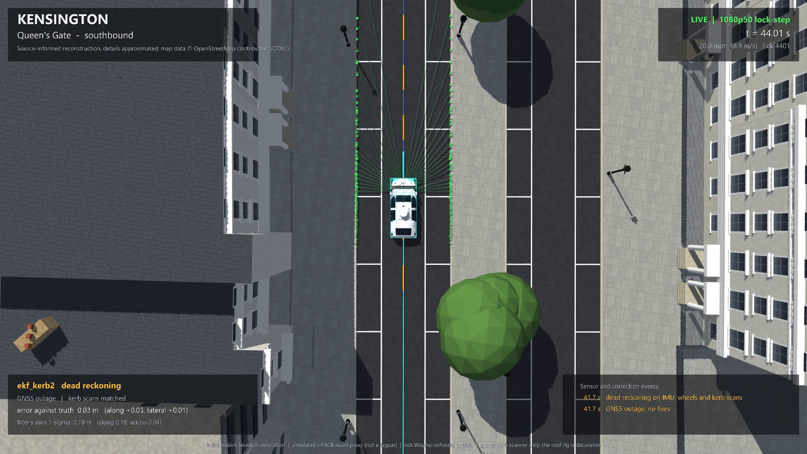
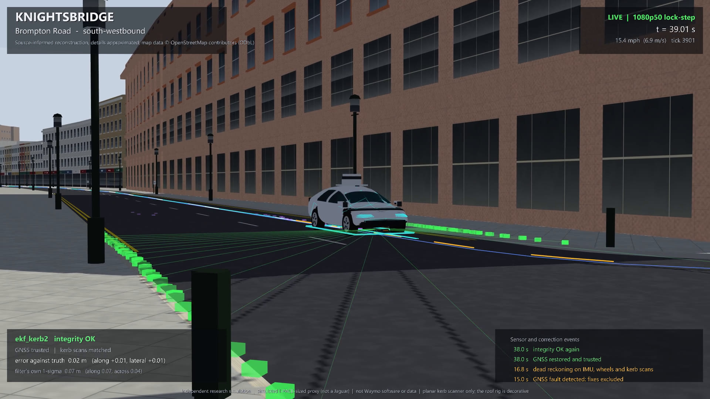
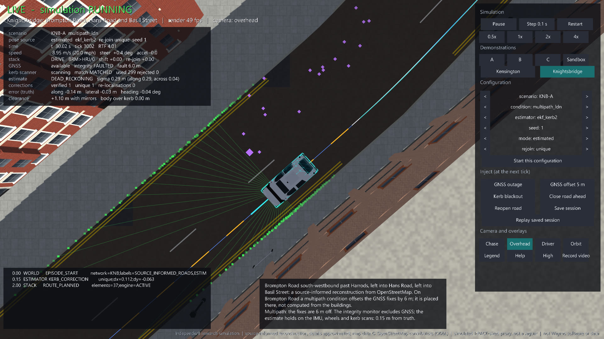
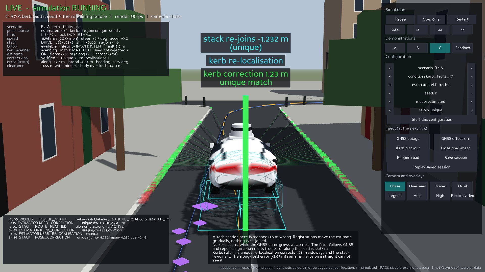
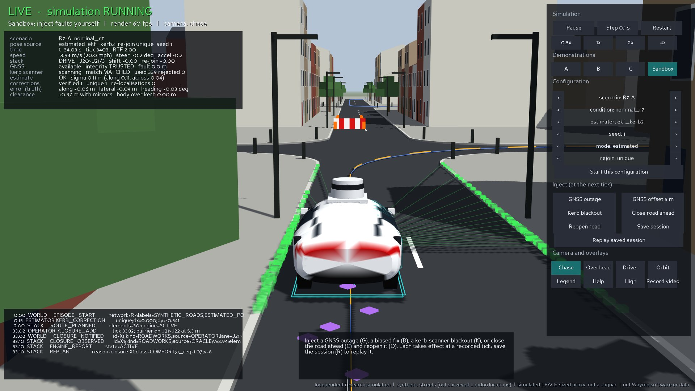

# Live 3D driving and localisation viewer

A native 3D application (Panda3D) that shows the road_driving simulation while it runs. A simulated I-PACE-sized proxy with a Waymo-style roof rig drives through synthetic London-style grids, or through reconstructions of real streets in Kensington and Knightsbridge; a Cybercab-inspired proxy drives through a reconstruction of San Francisco's SoMa, with right-hand traffic. The localisation system runs live, and the viewer shows what it measures, what it corrects and where it goes wrong.

Independent research simulation. The grids are synthetic. The London and San Francisco scenes are source-informed research reconstructions with approximated details, built from OpenStreetMap; they are not surveys. The cars are simulated proxies, not a Jaguar or a Tesla vehicle. Nothing here is Waymo or Tesla software or data.

[](https://github.com/easensoy/autonomous-navigation-engine/releases/tag/viewer-london-v1)

<sub><b>London showcase, 1920×1080 at 50 frames per second, 3 min 16 s:</b> two chapters, each one uninterrupted live run of the backend, recorded in lock-step at exactly 2 simulation ticks per frame. In Kensington the fixes stop for 24 s on Queen's Gate, and the filter dead-reckons on the IMU, the wheels and the kerbs. In Knightsbridge the fixes are biased by about 6 m for 22 s on Brompton Road, and the integrity monitor excludes them. Neither run touches a kerb. Map data © OpenStreetMap contributors.<br>
[Watch (MP4, 1080p50, 298 MB)](https://github.com/easensoy/autonomous-navigation-engine/releases/download/viewer-london-v1/ane-london-showcase-1080p50.mp4) · [Release, metadata and launch commands](https://github.com/easensoy/autonomous-navigation-engine/releases/tag/viewer-london-v1) · [London scenes](#london-scenes) · [Provenance](districts/PROVENANCE.md) · [Protocol](PROTOCOL.md) · [Assets](ASSETS.md)</sub>

[](../docs/media/sf-showcase-poster.jpg)

<sub><b>San Francisco showcase, 1920×1080 at 50 frames per second, 1 min 22 s:</b> one uninterrupted live run of SF-A under `gnss_outage_sf`, on seed 2, the evaluation seed [the protocol's rule](../benchmark/PROTOCOL_SF.md#the-showcase-recording) picks (the median closed-loop RMSE, 0.160 m). The fixes stop for the last 180 m of Townsend Street and the turn into 5th Street, and `ekf_kerb2` drives on the IMU, the wheels and the kerbs, on the Cybercab-inspired proxy. Right-hand traffic. Independent simulation: not a Tesla vehicle or Tesla software. Map data © OpenStreetMap contributors.<br>Recorded with `tools/make_showcase.py --showcase sf`; the video is not in the repository · [San Francisco scene](#san-francisco-scene) · [Evaluation](../benchmark/sf/README.md) · [Provenance](districts/PROVENANCE.md#san-francisco-soma)</sub>

## Launch

From the repository root, after building the backend (below):

```powershell
powershell -ExecutionPolicy Bypass -File road_driving\viewer\launch.ps1
```

`road_driving\viewer\launch.cmd` does the same. The first time, run it with `-Setup`: this creates `road_driving\viewer\.venv` and installs Panda3D 1.10.16 and panda3d-gltf there, apart from the C++ build. The launcher explains anything missing: Python, Panda3D, or the backend.

**The backend** is `road_drive`, built with the rest of road_driving:

```powershell
cmake -S . -B build\road-msvc -G Ninja -DCMAKE_BUILD_TYPE=Release -DBUILD_ROAD_DRIVING=ON
cmake --build build\road-msvc --target road_drive
```

Run these in a Visual Studio developer prompt. A GCC (MSYS2 UCRT64) build in `build\road-gcc` also works. The launcher looks in both, or uses `ANE_BACKEND`.

**Options** (any after the launcher's own are passed on):
- `--demo A|B|C|S|K|N|SF|SFB|SFD|SFM`: the demonstration to start with (default C). `--seed N` replaces its seed.
- `--scenario R7-B --condition gnss_outage_r7 --estimator ekf_int2 --seed 3`: any other configuration, `KEN-A`, `KNB-A`, `SF-A` and `SF-B` included; `--vehicle cybercab_proxy_v1` chooses the vehicle profile.
- `--hud present|diagnostic`: the compact presentation overlay, or the full panels (the default).
- `--replay SESSION`: start in REPLAY mode.
- `--quality low|medium|high`, `--size 1920x1080`, `--fullscreen`.
- `--camera chase|overhead|driver|orbit`.
- `--vehicle-model models\my.json`: draw an imported glTF ([models/README.md](models/README.md)).

`python -m ane_viewer --help` lists the rest, including recording, the camera director, scripted cameras, injections and screenshots.

## Demonstrations

| | Episode | What it shows |
|---|---|---|
| A | R7-A, nominal, seed 1, `ekf_kerb2` | Estimated-state driving: the stack drives on the estimate, kerb scans hold it within a few centimetres of truth |
| B | R3-B, slow GNSS excursion, seed 5, `ekf_kerb2` (development data) | The fixes drift sideways at 0.25 m/s with no jump. At the turn the kerb scans stop fitting (red), the filter re-localises on a unique kerb match, and the receiver must earn trust again |
| C | R7-A, kerb faults, seed 7, `ekf_kerb2`, unique re-join (held out) | The one failure of the [sixth evaluation](../LOCALISATION.md#sixth-evaluation-the-unique-re-join-held-out-on-r7), reproduced exactly: a correct correction, an along-road error the kerbs cannot see, and a 0.88 m crossing in the next turn |
| Sandbox | R7-A, nominal, seed 1 | Inject faults yourself and save the session |
| K | KEN-A, `gnss_outage_ldn`, seed 1, `ekf_kerb2`, unique re-join | Kensington Gore past the Royal Albert Hall, then the length of Queen's Gate. The fixes stop for 24 s on Queen's Gate: the filter dead-reckons for 22 s and keeps registering kerb scans, and the receiver earns trust again afterwards |
| N | KNB-A, `multipath_ldn`, seed 1, `ekf_kerb2`, unique re-join | Brompton Road past Harrods, then Hans Road, Basil Street and Hans Crescent. On Brompton Road the fixes are biased by about 6 m for 22 s: the integrity monitor flags them within 0.2 s and excludes them for 23 s |
| SF | SF-A, `gnss_outage_sf`, seed 901, `ekf_kerb2`, unique re-join, Cybercab-inspired proxy | Townsend Street past the rail yard, right into 5th Street, right into Brannan Street. The fixes stop over the straight's last 180 m and the turn's entry |
| SFB | SF-B, `gnss_outage_sf`, seed 901 | Brannan Street, left into 5th Street, left into Townsend Street towards the station corner, under the same outage |
| SFD | SF-A, `gnss_drift_sf`, seed 902 | A sustained drift to 4 m: the kerbs hold its lateral part; its along-road part reaches the turn |
| SFM | SF-A, `kerb_map_error_sf`, seed 901 | During the outage the vehicle's map has 110 m of Townsend Street's kerbs 0.6 m to the right (orange) |

Each demonstration is an ordinary configuration. Its captions are triggered by what the backend reports, and quote the live values. Nothing is scripted against time, smoothed or moved. K and N show the system at work in the two London scenes; they are not an evaluation.

SF to SFM run on development seeds (901 and 902); the evaluation's results are in [`benchmark/sf/`](../benchmark/sf/README.md).

## London scenes

Two bounded patches of real streets, about 1.5 km apart, each with its own network in the backend. They are separate scenes, recorded as separate chapters; no route joins them.

| | Kensington (`KEN`) | Knightsbridge (`KNB`) |
|---|---|---|
| Streets | Kensington Road and Kensington Gore, Queen's Gate (two carriageways about a central reservation), Prince Consort Road, Queen's Gate Terrace, Gore Street, Elvaston Place | Brompton Road, Hans Road (one-way from Brompton Road), Basil Street (one-way), Hans Crescent |
| Buildings drawn | 380: stucco terraces with porches, steps, light wells, area railings, balustrades, cornices and window surrounds; mansion blocks; the Royal Albert Hall's drum and dome | 558: shopfronts with fascias and awnings in brick and stone, mansion blocks in red brick; a terracotta department-store frontage with display windows, pilasters, copper cupolas and a dome |
| Route | `KEN-A`, 696 m | `KNB-A`, 637 m |

Each element is one of four kinds ([PROVENANCE.md](districts/PROVENANCE.md) lists them all):
- **Measured**, from the backend's map message, exactly as the simulation uses it: the carriageway inside the kerb lines and arcs, Queen's Gate's reservation, and the kerb upstand. A patch edge, where a street carries on beyond the model, is drawn as a hatched apron level with the road, because the scanner sees no kerb there.
- **Sourced** from OpenStreetMap: junction positions, street names, one-way rules and a turn restriction in the backend; building outlines, storeys, names, parks, trees, walls and railings in the scene.
- **Inferred:** carriageway widths, kerbs, turning paths, and building heights from their storeys.
- **Decorative:** facades, materials, roofs, extra trees, lamps, bollards, a K6 kiosk, a pillar box, street name plates and road markings. They stay off the carriageway and no simulated sensor sees them. Shop fascias carry generic words, and no real building's lettering, emblem or relief is reproduced.

`V` draws OpenStreetMap's centrelines (cyan) over the modelled lanes (amber). They agree to within 2.4 m, except on Queen's Gate, whose two mapped carriageways run 5.6 to 7.5 m either side of the modelled midline.

The facades are built from modules (`ane_viewer/facades.py`): storeys, bays, windows with surrounds, porches, balconies, cornices, parapets, railings and shopfronts, laid out per building from its outline, its storeys and its style. The style comes from the building's OpenStreetMap tags, name and street. The textures (brick, stucco, Portland stone, terracotta, slate, paving, asphalt, glazing) are generated at start from fixed seeds (`ane_viewer/materials.py`).

## San Francisco scene

One bounded patch of real streets in South of Market (SoMa), by the Caltrain station at 4th and Townsend, with **right-hand traffic**. Its network, `SF-SOMA`, and its scenery file come from one pinned OpenStreetMap extract ([provenance](districts/PROVENANCE.md#san-francisco-soma)).

| | SoMa (`SF-SOMA`) |
|---|---|
| Streets | Townsend Street, 5th Street (ending at Townsend, across from the rail yard), Brannan Street, 4th Street (one-way, two carriageways about the light-rail trackway), Bluxome Street |
| Buildings drawn | 183: brick warehouses and lofts with loading bays and steel windows, newer glazed blocks, and the station's low frontage; the rail yard's and the station's tracks |
| Routes | `SF-A`, 567 m (right turns, near side); `SF-B`, 671 m (left turns, across the opposing lane) |
| Vehicle | the Cybercab-inspired proxy (`cybercab_proxy_v1`) in the demonstrations; any configuration can take either profile (`--vehicle`) |

What differs from London:
- **Right-hand traffic.** The lane keeps right of the centre line, and the overlay says so. The markings follow a generic United States pattern: double yellow centre lines, white lane lines, continental crosswalks and stop lines at the modelled junctions, and Townsend Street's green bike lane.
- **A second vehicle.** The Cybercab-inspired proxy is drawn from its profile: a two-door fastback in champagne gold on the profile's wheelbase, length, width, height, wheels and track, with no exterior mirrors and no roof rig. Its GNSS antenna and kerb scanner are drawn where the profile mounts them. The overlay's footer names it and says what it is not.
- **The map error.** Under `kerb_map_error_sf`, where the vehicle's map has a kerb the world does not, an orange translucent strip shows the map's kerb beside the true one.

`V` draws OpenStreetMap's centrelines over the modelled lanes, as in London. They agree to within 1.4 m; 4th Street's two carriageways run 5.1 to 9.0 m either side of the modelled centre.

## Presentation mode

`--hud present`, or `M` while running, replaces the diagnostic panels with a compact overlay:
- the district and street, with the direction of travel;
- the route, condition, simulated time and speed;
- the estimator and its integrity state, with the GNSS and kerb-scanner states;
- the position error against truth beside the filter's reported sigma;
- the latest sensor and correction events.

It has no configuration controls, draws the GNSS fixes smaller, and leaves the event poles unlabelled. `M` brings the diagnostic panels back. Every overlay keeps its meaning in both modes.

## Cameras

**The obstruction.** In c3d65f5 the orbit camera held a fixed world heading, 19 to 24 m from the car, and nothing checked the space between the two. In demonstration C a terrace came between them, and the chase camera had no check either. The test `test_the_old_fixed_orbit_was_blocked_on_demo_c` reproduces the defect: that orbit is blocked for over 30% of demonstration C.

**The fix** ([`occlusion.py`](ane_viewer/occlusion.py), [`cameras.py`](ane_viewer/cameras.py)):
- The world builders register every building, wall and tree canopy they draw as a prism: its footprint and height range, on a spatial grid.
- Each frame, the chase and orbit cameras test the view they want: it must not be inside a prism, and at least three of four points on the car must be in sight.
- If either test fails, the camera pulls in along its ray, rises, or swings round to the nearest clear view. It keeps the last alternative it chose while that needs little pulling in, so it does not flicker between two, and the orbit glides from one alternative to the next over a quarter of a second.
- It pulls in at once, and eases back out at 2 m/s, only through clear space.
- Limits: the camera never goes below 1.2 m, the near plane is 0.3 m, and the orbit stays between 8° and 80° of pitch and at least 7 m out.
- A cut starts from the new camera's solved view, never from an eased one.

**The director** ([`director.py`](ane_viewer/director.py)) runs a fixed plan of shots for each route, against simulated time: chase, street level, low chase, orbit and overhead.
- A street-level camera stands on the far pavement ahead of the car, by the stack's planned path, with a clear view of it. No lamp column, kiosk or pillar box may stand within 12 m in any view it turns to while it follows the car. It cuts back to the chase camera when the car comes within 11 m or leaves its view.
- An orbit sweeps round whichever side of the car the scenery leaves more room on, along the path ahead. In left-hand traffic that is usually the right, across the carriageway.
- In Knightsbridge the camera stays at street level along the department store's frontage: from overhead, its dome would stand close under the camera.

**Checked:**
- In the tests, without Panda3D: the chase and orbit cameras over the whole of demonstration C and both London routes, turns and junctions included, are never inside geometry and always see at least three quarters of the car; every cut starts from a valid view; and a street-level camera stands on the pavement with a view, and moves away from a lamp column in line with the car.
- In every recording: each frame logs the camera's position, whether it is inside geometry, and the share of the car in view. `tools/check_recording.py` fails a recording with any frame inside geometry, or with less than three quarters of the car in view outside the overhead and driver's views.

## Controls

| Key | Action |
|---|---|
| Space | pause or resume. Simulated time and every sensor stop; the interface stays live |
| N, Shift+N | step 0.1 s, or one 10 ms tick |
| R | restart the configuration (or the replay) |
| F1 to F4 | demonstrations A, B, C, sandbox |
| F5, F6 | the London scenes: K (Kensington), N (Knightsbridge) |
| F7 | the San Francisco scene: SF |
| [ and ] | slower, faster (0.125x to 16x) |
| 1 2 3 4 | cameras: chase, overhead, driver (right-hand drive), orbit |
| right-drag, wheel, middle-drag, D | orbit: rotate, zoom, pan, detach from the car |
| M | presentation overlay or diagnostic panels |
| V | district scenes: OpenStreetMap centrelines over the modelled lanes |
| G | GNSS outage on or off |
| B | GNSS offset on or off: 5 m to the car's left, fixed in the map frame |
| K | kerb-scanner blackout on or off |
| C, O | close the road 40 m ahead (roadworks, oracle-notified), reopen it |
| S, P | save the session, replay the last saved one |
| L, H | legend, help |
| T, E, Y, Z | truth trail; estimate (car, trail and ellipse); returns placed from the estimate; condition zones |
| Q | quality |
| F12, F9 | screenshot; record video |
| Tab, Esc | hide the panels, quit |

The panel on the right has the same controls, plus selectors for any route, condition, estimator, seed, pose source and re-join setting.

Injections and the closure take effect at the next simulation tick the backend runs. The backend records that tick, and the events panel shows it.

The banner always says whether this is LIVE simulation or a recorded REPLAY. In a replay the commands come from the session file, and the end line reports whether the recorded trace was reproduced.

## What is drawn

Everything comes from the backend's messages ([PROTOCOL.md](PROTOCOL.md)). The viewer never moves the car itself.

| Overlay | Meaning |
|---|---|
| Solid white car, white trail | the simulated truth, at the tick's true rear-axle pose; steering and wheel rotation from the simulated state |
| Teal wireframe car, teal footprint and trail | the estimate the stack drives on |
| Teal ring, two lines | the filter's own 95% position ellipse (2.45 sigma of its reported covariance), and its heading spread |
| Amber dashes, blue line | the reference the controller follows (path plus clearance shift and re-join), and the adopted route |
| Violet marks | raw GNSS fixes, with multipath, ramps and injected offsets; the newest is larger |
| Green or red points and rays | the kerb scanner's returns, drawn from the scanner's true pose, coloured by the filter's decision on that scan: used or rejected |
| Cyan points (Y) | the same returns placed from the estimated pose, where the filter believes they landed |
| Poles with labels | where a kerb correction (unique match or not), a re-localisation, a re-join, a monitor trigger, a fallback stop or a closure event happened |
| Shaded ground (Z) | the sensor condition's zones: outage, multipath, ramp, kerb blackout, kerb map error |
| Red and white barrier, cones | the closure, where the backend placed it |

The left panel shows:
- the configuration, simulated time, tick and real-time factor;
- speed, steering and acceleration;
- the stack's mode, element, shift and re-join;
- GNSS availability, integrity state and fault size;
- the kerb scanner's state and its used and rejected scans;
- the estimate's status and reported sigmas;
- the corrections: verified, unique and re-localisations;
- from truth: along-road, lateral and heading error, clearance with mirrors, and depth over the kerb.

Truth is used only for drawing and for these diagnostics. It never reaches the estimator or the controller.

**The roof rig and fender pods are decorative.** The simulation has no 3D lidar and no camera. Its only ranging sensor is the planar kerb scanner on the front bumper (orange stripe): 37 beams at kerb height over ±90°, 0.5 to 25 m, 10 Hz. Its beams are drawn from every scan.

## How it works

```
viewer (Python, Panda3D)  --stdin: commands------------->  road_drive live (C++)
   draws, never simulates <--stdout: JSON messages, v1----  the episode loop of road_drive drive,
   captures frames           stderr: diagnostics -> log     with two hooks per 10 ms tick
```

**The backend.** It runs the episode loop every headless run uses (`runEpisode`), with two hooks per tick (`src/live_hooks.hpp`):
- one before the sensors step, which applies operator commands;
- one after the control step, which reports.

A headless run passes no hooks, so its calculations, random draws and sensor timestamps are unchanged: the 192-episode suite stays byte-identical, and the held-out closed loops reproduce value for value.

**The faults.**
- An injected GNSS outage still draws the fixes' noise, so the other sensors' streams stay aligned.
- An offset is added without any new draw.
- A kerb blackout behaves like the conditions' own blackout zones.
- A closure is placed on the stack's route and evaluated like a scenario's own closure.

**Pacing.** It only waits between ticks, and reports when the machine cannot keep up.

**The viewer.** It reads messages on a thread and draws the newest state each frame. Rendering at 60 frames per second and simulating at 100 ticks per second are independent.

**Sessions.** A session file holds the configuration and each world command with the tick it took effect at. `road_drive session-replay FILE` replays it headlessly, bit for bit on the same toolchain.

The street is built from the map message, using the exact kerb lines and corner arcs that the kerb scanner and the clearance checks use:
- **Measured:** the carriageway inside those kerbs, the closure, and the parked cars the scanner can see.
- **Decorative:** on the grids, pavements, kerb stones, markings, terraced houses, lamps, trees, bollards, a telephone kiosk and a post box; in the London scenes, the OpenStreetMap scenery above. They stand on the pavement side of the kerb, and the simulation never sees them.

## Recording

`--record-video FILE` records in lock-step:
- The backend starts paused, and is advanced exactly k ticks for each frame: 2 at 50 frames per second. The video therefore plays at real time, however long a frame takes to draw and encode.
- With `--record-size 1920x1080`, frames are rendered at that size into an offscreen buffer with 8× multisampling, whatever the window's size. They are rendered at 1080p, not scaled up.
- ffmpeg encodes H.264, High profile, yuv420p, at CRF 18 with preset slow, a keyframe every second, and the BT.709 colour matrix. The index goes at the front of the file (fast start), so it plays while downloading.
- `--frame-log` writes one line per frame: the tick, simulated time, shot and camera, the camera's position, whether it is inside geometry, the share of the car in view, and the clock the overlay shows.

Encoding needs ffmpeg, found on `PATH`, through `ANE_FFMPEG` or in the imageio-ffmpeg package; without it the frames are saved as PNG files.

The showcase is made by one script, from `road_driving\viewer`:

```powershell
.venv\Scripts\python.exe tools\make_showcase.py captures\showcase
```

It records the two chapters. Each has a 3 s title card, the uninterrupted run, and a 3 s end card with the backend's own evaluation of the run. It joins them without re-encoding, with a chapter mark each, and runs `tools\check_recording.py`. That checks:
- the codec, profile, pixel format, size, frame rate, frame count, duration, fast start and chapters;
- in each frame log, that every run frame advances exactly 2 ticks. The only exception is the last, when the episode ends one tick after a frame;
- the cards, the camera checks above, and the overlay's clock against the tick.

It then writes the metadata: scenario, condition, seed, estimator, the backend's commit and toolchain, each run's outcome and trace hash, the settings, and the file's size and SHA-256.

The San Francisco showcase is one chapter, on the evaluation seed the protocol's rule picks from the stored results; the script applies the rule and writes it to the metadata:

```powershell
.venv\Scripts\python.exe tools\make_showcase.py captures\sf-showcase --showcase sf
```

One chapter on its own:

```powershell
.venv\Scripts\python.exe -m ane_viewer --demo K --hud present --director KEN-A --quality high --record-video ken.mp4 --record-size 1920x1080 --record-fps 50 --frame-log ken.frames.jsonl --exit-at-end
```

## Verification

**C++, `ctest` (no graphics):**
- `road_driving_live_tests`, 23 checks:
  - a live run without commands equals the headless run, for four configurations;
  - a session replays to the live trace;
  - observing every 7th tick, pacing at 40x, and pausing and stepping change nothing;
  - injected faults leave no fix or scan inside them, an offset moves the fix by exactly itself, and the sensors are unchanged up to the injection;
  - reset starts fresh;
  - the server stops when its input closes;
  - a replay refuses new world commands.
- `road_driving_session_replay` replays `examples/sandbox_session.json`, recorded through this viewer with six operator commands, a closure and its reopening among them.
- `road_driving_district_tests`, 31 checks, on the London networks, and `road_driving_sf_tests`, 44 checks, on San Francisco and the vehicle profiles ([road_driving README](../README.md#build-test-run)).

**Python, `python -m unittest discover -s road_driving/viewer/tests` (62 tests; the 3 that need Panda3D are skipped without it, as in CI):**
- the kerb loops close: one outer kerb, one loop per block;
- every lane lies on the carriageway, and no building or furniture does;
- in the London scenes, no building outline comes within 0.5 m of a kerb, no tree within 0.8 m, and no park within 2 m; the cameras' prisms are the drawn buildings and canopies; the scenery files carry their licence and source;
- the cameras, as above;
- the recording checks: tick steps, cards, the camera checks and the clock;
- the proxy matches the footprint: length, width over the body and over the mirrors, axles, scanner mount;
- the imported-model alignment places the rear bumper and the ground correctly;
- the protocol, the events panel, the captions and the presentation overlay;
- in San Francisco: the scenery's source and frame, no building or tree on or against a kerb, the station and no trees on the trackway, the overlay's street names and vehicle wording, the map error beside the true kerb, the Cybercab-inspired proxy against the backend's footprint and mounts, and the I-PACE proxy for older scene messages;
- with a built backend:
  - a live run equals the headless one, failure included;
  - pause freezes ticks, and a step of 7 runs exactly 7;
  - closing the viewer's pipe ends the backend in under 3 s with code 0;
  - an injected session replays headlessly.

**The showcase,** checked as above: 1920×1080 at 50 frames per second, H.264 High profile, yuv420p, 12157 kbit/s, fast start, 9,797 frames over 195.94 s (3 min 16 s), two chapters; 298 MB (297,879,102 bytes). Every run frame advanced exactly 2 ticks (the last frame of an episode that ends between frames advances 1), no frame had the camera inside geometry, all of the car's test points were in view in every chase, orbit and street-level frame, and the overlay's clock matched the tick in every frame. SHA-256 `b09b4ba212bbe67b4c7ce2c10830733fe03fb37945f5d7490fef2ef5dfced671`.

**The San Francisco showcase,** checked the same way: 1920×1080 at 50 frames per second, H.264 High profile, yuv420p, 11682 kbit/s, fast start, 4,107 frames over 82.14 s (1 min 22 s), one chapter; 120 MB (120,002,409 bytes). Every run frame advanced exactly 2 ticks, no frame had the camera inside geometry, all of the car's test points were in view in every chase, orbit and street-level frame, and the overlay's clock matched the tick in every frame. The run: COMPLETED, trace `0x0098b51eb18ff1e5`. SHA-256 `24adb7157da0dfec387d012da0d17e13fa7021b9aaa892c0d1134285167acd7c`. ffprobe is not installed on the recording machine; the checker reads the same stream fields from ffmpeg and counts the frames with a stream copy.

**Existing evidence.** The 192-episode suite is byte-identical with GCC and MSVC. The held-out closed loops reproduce: a sample of R7-A, 850 episodes, every value equal. All earlier tests and evidence checks pass.

**Compilers.** Demonstration C reproduces the evaluation's episode bit for bit (trace `0x58876d2b4ce5fe2c`) with MSVC 19.51, which ran the evaluation and which the launcher prefers. A GCC 14.2 backend gives the same outcome, crossing and errors to the printed precision, but a different trace hash: on estimated pose, runs are not bit-identical across compilers. Each evaluation therefore compares runs from one compiler.

## Performance

Measured on 18 November 2026 on one laptop: Intel Core Ultra 7 165H, Windows 11, a 60 Hz display. Each run played a demonstration live at 1x, after a second of warm-up, with `--benchmark 30`. Memory and processor time were sampled every second; the GPU's load and memory came from `nvidia-smi`, which reads only the NVIDIA GPU.

**The London scenes,** quality high, in a 1920×1080 window:

| GPU | Scene | Vsync | Frames per second | Frame time, median / 95th percentile / longest | Viewer CPU, share of one core | Viewer memory | GPU load, memory |
|---|---|---|---|---|---|---|---|
| Intel Arc (integrated) | Kensington (K) | on | 53.1 | 16.96 / 32.01 / 36.7 ms | 56% | 807 MB | not measured |
| Intel Arc (integrated) | Kensington (K) | off | 91.0 | 10.82 / 17.54 / 25.8 ms | 66% | 807 MB | not measured |
| Intel Arc (integrated) | Knightsbridge (N) | on | 40.6 | 22.94 / 34.10 / 51.0 ms | 54% | 778 MB | not measured |
| Intel Arc (integrated) | Knightsbridge (N) | off | 73.1 | 12.60 / 28.88 / 59.1 ms | 86% | 779 MB | not measured |
| RTX 1000 Ada | Kensington (K) | on | 60.0 | 16.63 / 23.76 / 33.1 ms | 109% | 338 MB | 44%, 1663 MB |
| RTX 1000 Ada | Kensington (K) | off | 88.2 | 9.90 / 23.53 / 34.2 ms | 113% | 325 MB | 62%, 1663 MB |
| RTX 1000 Ada | Knightsbridge (N) | on | 60.0 | 16.56 / 24.87 / 46.5 ms | 111% | 312 MB | 52%, 1649 MB |
| RTX 1000 Ada | Knightsbridge (N) | off | 78.9 | 11.37 / 23.04 / 37.3 ms | 116% | 292 MB | 73%, 1649 MB |

**The grids,** demonstration C in a 1920×1080 window:

| GPU | Quality | Vsync | Frames per second | Frame time, median / 95th percentile / longest | Viewer CPU, share of one core | Viewer memory | GPU load, memory |
|---|---|---|---|---|---|---|---|
| Intel Arc (integrated) | low | on | 60.0 | 16.67 / 17.97 / 21.4 ms | 37% | 198 MB | not measured |
| Intel Arc (integrated) | low | off | 431.9 | 1.67 / 5.00 / 26.2 ms | 96% | 206 MB | not measured |
| Intel Arc (integrated) | medium | on | 59.9 | 16.63 / 18.16 / 33.1 ms | 41% | 655 MB | not measured |
| Intel Arc (integrated) | medium | off | 174.0 | 5.33 / 16.30 / 29.1 ms | 72% | 661 MB | not measured |
| Intel Arc (integrated) | high | on | 59.5 | 16.67 / 18.40 / 40.9 ms | 39% | 700 MB | not measured |
| Intel Arc (integrated) | high | off | 182.4 | 5.11 / 15.99 / 26.1 ms | 69% | 700 MB | not measured |
| RTX 1000 Ada | low | on | 60.0 | 16.67 / 17.97 / 25.1 ms | 104% | 236 MB | 10%, 73 MB |
| RTX 1000 Ada | low | off | 367.4 | 1.98 / 6.06 / 31.9 ms | 132% | 222 MB | 36%, 73 MB |
| RTX 1000 Ada | medium | on | 60.0 | 16.67 / 20.24 / 36.8 ms | 108% | 245 MB | 58%, 1603 MB |
| RTX 1000 Ada | medium | off | 89.2 | 10.53 / 18.56 / 39.3 ms | 110% | 229 MB | 89%, 1603 MB |
| RTX 1000 Ada | high | on | 60.0 | 16.64 / 21.34 / 34.4 ms | 109% | 236 MB | 58%, 1624 MB |
| RTX 1000 Ada | high | off | 88.6 | 10.14 / 21.74 / 41.7 ms | 112% | 237 MB | 84%, 1624 MB |

What the runs show:
- **The London scenes are heavier than the grids:** 380 and 558 textured buildings with modular facades. Uncapped, the integrated GPU renders them at 91 and 73 frames per second, and the RTX at 88 and 79.
- **With vsync, the integrated GPU does not hold 60 Hz there:** 53 frames per second in Kensington and 41 in Knightsbridge. A frame that misses a 16.7 ms refresh waits for the next one, so the 95th percentile is 32 to 34 ms. At quality medium it gives 48 and 46, so multisampling and shadows are not the limit. `launch.ps1 -Gpu nvidia` holds 60 Hz in both scenes, 95th percentile 24 to 25 ms.
- **The simulation kept to real time in every London run:** real-time factor 0.995 to 1.010, with no lag event. The backend used 2 to 4% of one core and at most 12 MB.
- **Memory:** 0.78 to 0.81 GB for the viewer on the integrated GPU; on the RTX 0.29 to 0.34 GB, and 1.66 GB on the GPU.
- **Recording is separate from live speed.** The showcase was rendered offscreen at 1920×1080 with 8× multisampling and encoded with x264's slow preset at 12 to 13 frames a second on the integrated GPU, about 13 minutes for its 3 min 16 s. The lock-step makes the video the same at any rendering speed.
- **On the grids, the simulation kept to real time in every run:** real-time factor 0.995 to 1.005, with no lag event. The backend used 4 to 8% of one core and at most 14 MB. Unpaced, it plays the whole of demonstration C, 79.6 s of simulated time, in 3.25 s.
- **With vsync, every grid setting holds the display's 60 Hz on either GPU:** 59.5 to 60.0 frames per second, 95th percentile at most 21.3 ms. The viewer then uses about 40% of one core on the integrated GPU, and a little over one core on the RTX.
- **Windows renders on the integrated GPU by default,** and `launch.ps1 -Gpu nvidia` selects the RTX for the viewer's process only. Uncapped on the grids, the RTX was the slower of the two here: 367, 89 and 89 frames per second against 432, 174 and 182. This is probably NVIDIA Optimus: each frame the RTX renders is copied to the display, which the integrated GPU drives, and the scene is too light to repay that.
- **Quality** sets multisampling (none, 4 or 8 samples) and the shadow map (none, 1024 or 2048 pixels) at start; `low` also draws every other house and no trees. `Q` changes the scenery while running, and `--quality` the rest.
- **Memory:** on the integrated GPU the viewer's memory rises from 0.20 GB at `low` to 0.66 to 0.70 GB with multisampling and shadows, because an integrated GPU's buffers are in system memory. On the RTX it stays near 0.24 GB, and the GPU holds 73 MB at `low` and 1.6 GB at `medium` and `high`, of its 6 GB.
- **The first frame takes 0.6 to 0.7 s,** while Panda3D compiles the scene's shaders; that second is excluded above. Saving a screenshot takes about 0.13 s.

## Screenshots

| | |
|---|---|
|  |  |
| **Kensington, 60.5 s, low chase.** Queen's Gate southbound, 19 s into the filter's dead reckoning. No GNSS fix has arrived for 21 s; every kerb scan is registered (green). Error against truth 0.03 m; reported sigma 0.09 m. | **Kensington, 44.0 s, overhead.** Queen's Gate's two carriageways, which the network models as one street about their midline, with the parking bays either side of the central reservation. The buildings stand on OpenStreetMap's outlines. |
|  |  |
| **Knightsbridge, 39.0 s, street level.** Brompton Road, beside the department store's frontage, 1 s after GNSS is trusted again. The car turns into Hans Road in front of this camera. | **Knightsbridge, 30.0 s, overhead, diagnostic panels (`M`).** The multipath condition's fixes (violet) lie about 6 m to one side, and integrity reads FAULTED. The filter dead-reckons 0.15 m from truth. The right panel holds every control, the London scenes included. |

| | |
|---|---|
|  |  |
| **C, the turn at J23, overhead.** The remaining failure of the sixth evaluation, live: R7-A, kerb faults, seed 7, `ekf_kerb2` with the unique re-join. A correct 1.23 m kerb correction left 2.7 m of along-road error the kerbs could not see on the straight. In the right turn at J23 it becomes lateral error, and the body goes 0.88 m over the kerb. The run is reproduced exactly, crossing included. | **C, 50.0 s, overhead.** Kerb blackout (shaded): no scans, so the filter follows GNSS, whose error grows at 0.3 m/s. It reports a sigma of 0.14 m while its estimate (teal) is 2.81 m behind the car and 1.75 m to its left. |
|  |  |
| **C, 54.8 s, chase.** The kerbs return. A unique re-localisation corrects the estimate 1.23 m sideways and the stack re-joins it; the poles mark where. The along-road error, 2.67 m, remains: on a straight the kerbs cannot see it. | **A, 20.0 s, orbit.** Nominal driving on `ekf_kerb2`'s estimate: every kerb return used (green), the teal footprint on the car, lateral error 0.00 m against a reported 0.04 m. |
|  |  |
| **A, 30.1 s, driver camera** (right-hand drive; the car is hidden): the synthetic street, the kerb returns, the planned reference (amber) and the route (blue). | **B, 38.4 s, overhead.** R3-B, a slow GNSS excursion (development data). The fixes (violet) have drifted sideways. At the turn the kerb scan stops fitting the estimate and is rejected (red); 0.15 s later the filter re-localises 0.55 m on a unique kerb match, and the car completes with no crossing. |
|  |  |
| **Sandbox, 34.0 s, chase.** `C` at 33 s closed the road 40 m ahead: the events panel shows the command at tick 3302 and the barrier's lane. The barrier stands where the backend placed it, and the stack has replanned to turn right at J21. | **Replay of the sandbox session, 37.1 s, orbit, legend on (`L`).** The banner says REPLAY, and the events panel lists the session's commands at their recorded ticks. The legend says what each overlay means, and that the roof rig is decorative. |

[**Demonstration C's recording**](../docs/media/viewer-demo-c.mp4) (MP4, 79 s, 1280×720, 9.9 MB): from start to end, uninterrupted, with the cameras changing at fixed simulated times. It was recorded at 25 frames per second, 4 ticks a frame.

**How they were made.** Every image and both videos come from this viewer, unedited apart from conversion to JPEG. The poster and three of the London images are frames of the showcase video. The others were taken live at 4x, at a simulated time; the panels are refreshed for that tick first. From `road_driving\viewer`:

```powershell
.venv\Scripts\python.exe -m ane_viewer --demo C --size 1280x720 --quality high --record-video viewer-demo-c.mp4 --record-fps 25 --camera-at "0:chase,12:orbit@24,38:overhead@80,52:chase,56.5:overhead@42,64.5:orbit@22,72:chase" --exit-at-end
```

```powershell
.venv\Scripts\python.exe -m ane_viewer --demo C --size 1920x1080 --quality high --speed 4 --camera-at "0:chase,48:overhead@75,54:chase,59:overhead@42" --screenshots 50,54.7,61.44 --shot-dir captures --benchmark 18
```

```powershell
.venv\Scripts\python.exe -m ane_viewer --demo N --size 1920x1080 --quality high --speed 4 --camera-at "0:chase,26:overhead@50" --screenshots 30 --shot-dir captures --exit-at-end
```

## Limitations

**The vehicle model.**
- It is a kinematic bicycle about the rear axle: no tyre slip, load transfer, suspension, roll or pitch, so the drawn body stays level.
- Steering and acceleration follow first-order lags with rate limits.

**The sensors.**
- GNSS gives 2D fixes with a constant reported sigma; the IMU, planar specific force and yaw rate; plus wheel speed and steering angle.
- The kerb scanner is a 2D range scanner against the mapped kerbs, with a modelled deviation, clutter, dropouts and the parked cars of some conditions.
- There is no 3D lidar, camera, radar, point cloud or lane-marking detection. The roof rig shows none.
- No sensor sees a building: the multipath in Knightsbridge is a condition zone placed on Brompton Road, not computed from the frontages.

**The world.**
- Synthetic grid networks R1 to R7, two London patches and one San Francisco patch, with no other traffic, pedestrians or cyclists, and no signals or crossings.
- The London scenes approximate kerb positions, widths, parking and junction geometry, model Queen's Gate's two carriageways as one street about their midline, and leave out minor side streets ([PROVENANCE.md](districts/PROVENANCE.md)). The San Francisco scene models 4th Street's two carriageways as one street about the trackway's centre, and leaves out the all-way stop and the signals.
- The facades show each building type's elements and proportions, not a survey of any building. Heights come from storey counts.
- Lighting and the buildings are cosmetic: no sensor sees them.

**The viewer.**
- Panda3D's automatic shader, one shadow-casting sun near the car, and no levels of detail. The overlays are unlit and drawn without it, so a marker appearing never waits for a shader to compile.
- The camera's obstruction checks use prisms: a footprint extruded between two heights. Roofs, cupolas and canopies are approximated by them.
- The imported-model path is tested only with synthetic bounds, because no redistributable I-PACE model was available ([ASSETS.md](ASSETS.md)).
- A recording renders offscreen, but its window must stay open: closing it, or pressing Esc in it, ends the episode early. The checks then fail the recording, because its end is missing from the frame log.

## Files

| Path | What |
|---|---|
| `launch.ps1`, `launch.cmd` | Windows launcher and one-time setup |
| `ane_viewer/app.py` | the application: input, frame loop, panels, recording |
| `ane_viewer/backend.py`, `protocol.py`, `state.py` | the backend process, the protocol, what the viewer knows |
| `ane_viewer/geometry.py`, `world.py` | the street from the map (pure geometry, then Panda3D nodes) |
| `ane_viewer/district_layout.py`, `district_scene.py` | the district scenes, London and San Francisco: the layout from the map and the scenery file (pure), then the nodes |
| `ane_viewer/facades.py`, `materials.py`, `render_util.py` | modular facades and landmarks, procedural textures, mesh builders |
| `ane_viewer/occlusion.py`, `cameras.py`, `director.py` | obstruction checks, the cameras, the recorded shot plans |
| `ane_viewer/vehicle_mesh.py`, `vehicle3d.py`, `align.py` | the proxy (pure meshes), its node, imported-model alignment |
| `ane_viewer/overlays.py`, `hud.py`, `presentation.py`, `demos.py`, `capture.py` | overlays, diagnostic panels, the presentation overlay, demonstrations, screenshots and video |
| `districts/` | the OpenStreetMap scenery files and their [provenance](districts/PROVENANCE.md) |
| `tools/make_showcase.py`, `tools/check_recording.py` | the showcase recording, and its checks and metadata |
| `tests/` | the viewer's tests, with recorded scene messages and truth traces |
| `examples/sandbox_session.json` | a session recorded through the viewer, replayed by ctest |
| `PROTOCOL.md`, `ASSETS.md`, `models/README.md` | the protocol, asset provenance, importing a model |
