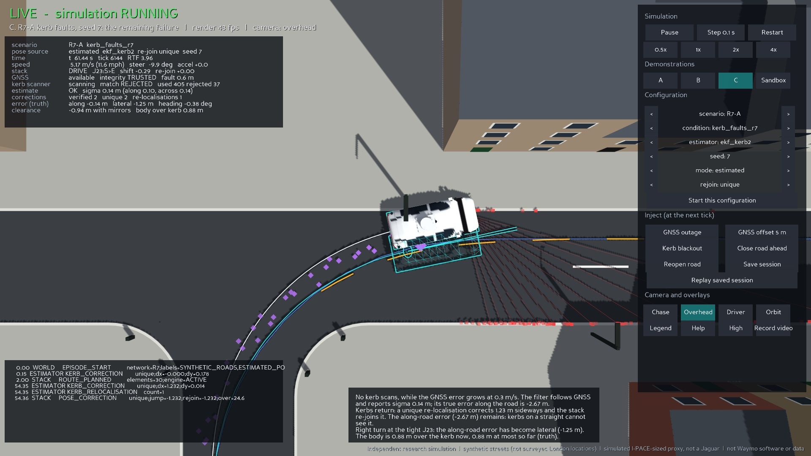
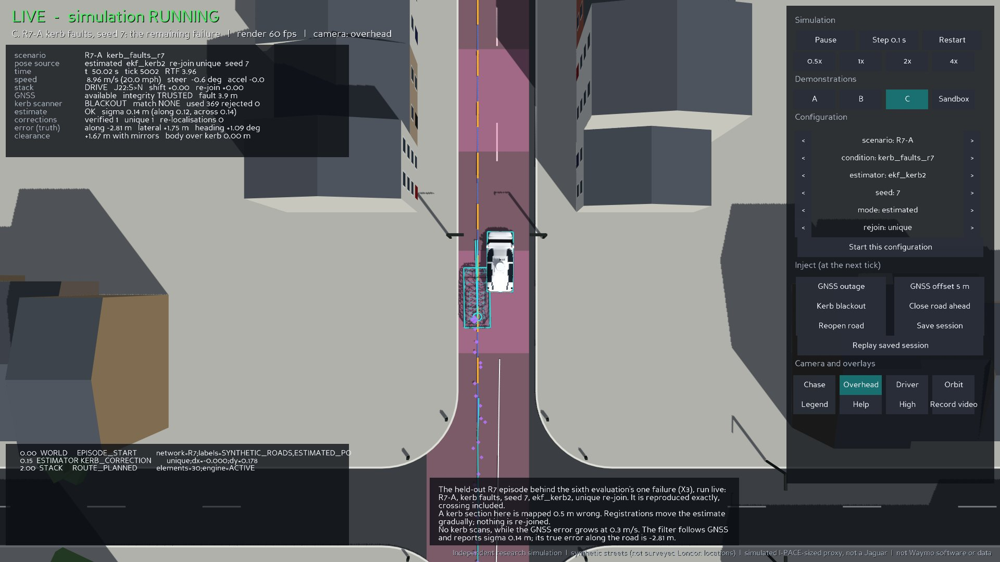
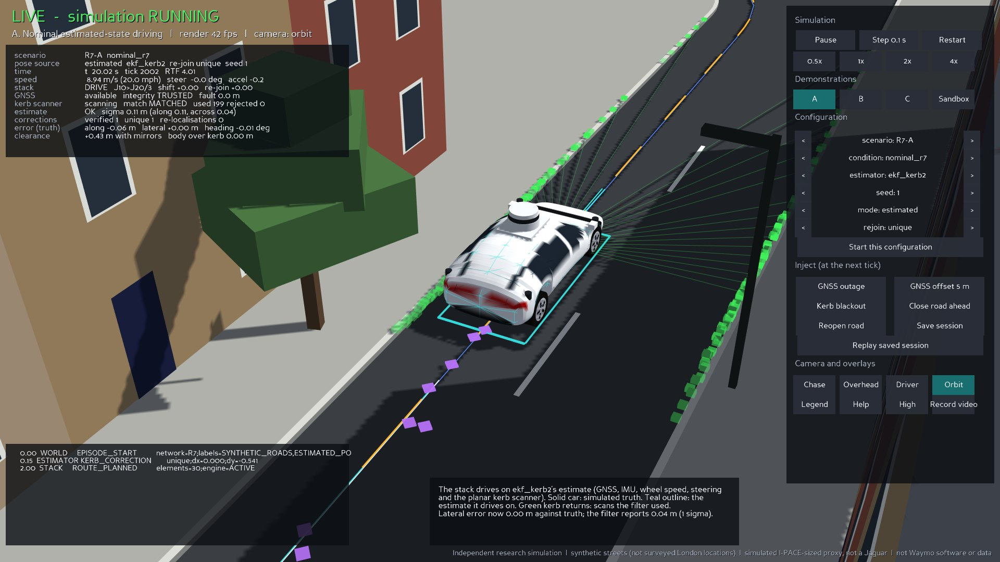
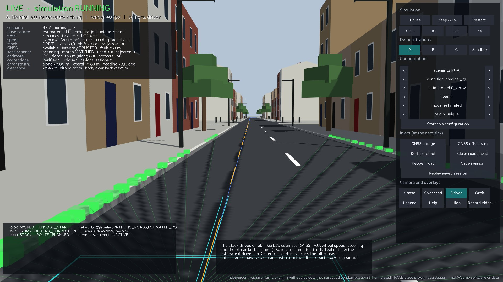
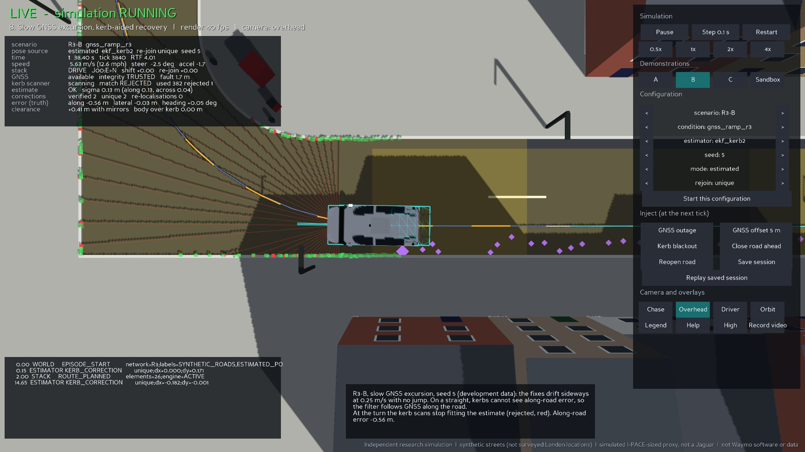
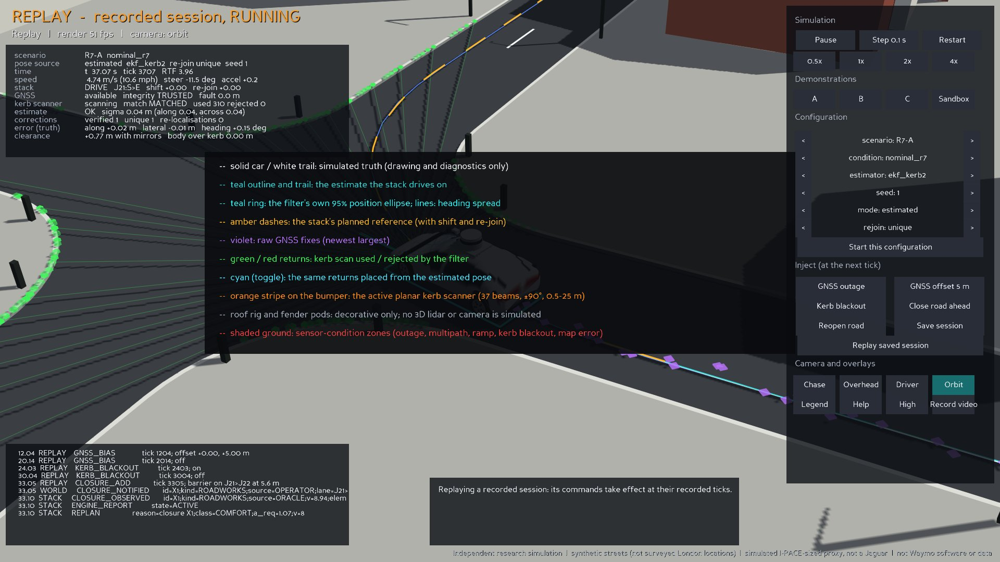

# Live 3D driving and localisation viewer

A native 3D application (Panda3D) that shows the road_driving simulation while it runs: a simulated I-PACE-sized proxy with a Waymo-style roof rig drives through a synthetic London-style street. The localisation system runs live, and the viewer shows what it measures, what it corrects and where it goes wrong.

Independent research simulation. The streets are synthetic, not surveyed London locations. The car is a simulated proxy, not a Jaguar. Nothing here is Waymo software or data.



<sub><b>The remaining failure of the sixth evaluation, live:</b> R7-A, kerb faults, seed 7, ekf_kerb2 with the unique re-join. A correct 1.23 m kerb correction left 2.7 m of along-road error the kerbs could not see on the straight. In the right turn at J23 it becomes lateral error, and the body goes 0.88 m over the kerb. The run is reproduced exactly, crossing included.<br>
[Full recording (MP4)](../docs/media/viewer-demo-c.mp4) · [More screenshots](#screenshots) · [Protocol](PROTOCOL.md) · [Asset provenance](ASSETS.md)</sub>

## Launch

From the repository root, after building the backend (below):

```powershell
powershell -ExecutionPolicy Bypass -File road_driving\viewer\launch.ps1
```

`road_driving\viewer\launch.cmd` does the same. The first time, run it with `-Setup`: this creates `road_driving\viewer\.venv` and installs Panda3D 1.10.16 and panda3d-gltf there, apart from the C++ build. The launcher explains anything missing: Python, Panda3D, or the backend.

**The backend** is `road_drive`, built with the rest of road_driving:

```powershell
cmake -S . -B build\road-msvc -G Ninja -DCMAKE_BUILD_TYPE=Release -DBUILD_ROAD_DRIVING=ON
cmake --build build\road-msvc --target road_drive
```

Run these in a Visual Studio developer prompt. A GCC (MSYS2 UCRT64) build in `build\road-gcc` also works. The launcher looks in both, or uses `ANE_BACKEND`.

**Options** (any after the launcher's own are passed on):
- `--demo A|B|C|S`: the demonstration to start with (default C).
- `--scenario R7-B --condition gnss_outage_r7 --estimator ekf_int2 --seed 3`: any other configuration.
- `--replay SESSION`: start in REPLAY mode.
- `--quality low|medium|high`, `--size 1920x1080`, `--fullscreen`.
- `--camera chase|overhead|driver|orbit`.
- `--vehicle-model models\my.json`: draw an imported glTF ([models/README.md](models/README.md)).

`python -m ane_viewer --help` lists the rest, including scripted cameras, injections and screenshots.

## Demonstrations

| | Episode | What it shows |
|---|---|---|
| A | R7-A, nominal, seed 1, `ekf_kerb2` | Estimated-state driving: the stack drives on the estimate, kerb scans hold it within a few centimetres of truth |
| B | R3-B, slow GNSS excursion, seed 5, `ekf_kerb2` (development data) | The fixes drift sideways at 0.25 m/s with no jump. At the turn the kerb scans stop fitting (red), the filter re-localises on a unique kerb match, and the receiver must earn trust again |
| C | R7-A, kerb faults, seed 7, `ekf_kerb2`, unique re-join (held out) | The one failure of the [sixth evaluation](../LOCALISATION.md#sixth-evaluation-the-unique-re-join-held-out-on-r7), reproduced exactly: a correct correction, an along-road error the kerbs cannot see, and a 0.88 m crossing in the next turn |
| Sandbox | R7-A, nominal, seed 1 | Inject faults yourself and save the session |

Each demonstration is an ordinary configuration. Its captions are triggered by what the backend reports, and quote the live values. Nothing is scripted against time, smoothed or moved.

## Controls

| Key | Action |
|---|---|
| Space | pause or resume. Simulated time and every sensor stop; the interface stays live |
| N, Shift+N | step 0.1 s, or one 10 ms tick |
| R | restart the configuration (or the replay) |
| F1 to F4 | demonstrations A, B, C, sandbox |
| [ and ] | slower, faster (0.125x to 16x) |
| 1 2 3 4 | cameras: chase, overhead, driver (right-hand drive), orbit |
| right-drag, wheel, middle-drag, D | orbit: rotate, zoom, pan, detach from the car |
| G | GNSS outage on or off |
| B | GNSS offset on or off: 5 m to the car's left, fixed in the map frame |
| K | kerb-scanner blackout on or off |
| C, O | close the road 40 m ahead (roadworks, oracle-notified), reopen it |
| S, P | save the session, replay the last saved one |
| L, H | legend, help |
| T, E, Y, Z | truth trail; estimate (car, trail and ellipse); returns placed from the estimate; condition zones |
| Q | quality |
| F12, F9 | screenshot; record video |
| Tab, Esc | hide the panels, quit |

The panel on the right has the same controls, plus selectors for any route, condition, estimator, seed, pose source and re-join setting.

Injections and the closure take effect at the next simulation tick the backend runs. The backend records that tick, and the events panel shows it.

The banner always says whether this is LIVE simulation or a recorded REPLAY. In a replay the commands come from the session file, and the end line reports whether the recorded trace was reproduced.

## What is drawn

Everything comes from the backend's messages ([PROTOCOL.md](PROTOCOL.md)). The viewer never moves the car itself.

| Overlay | Meaning |
|---|---|
| Solid white car, white trail | the simulated truth, at the tick's true rear-axle pose; steering and wheel rotation from the simulated state |
| Teal wireframe car, teal footprint and trail | the estimate the stack drives on |
| Teal ring, two lines | the filter's own 95% position ellipse (2.45 sigma of its reported covariance), and its heading spread |
| Amber dashes, blue line | the reference the controller follows (path plus clearance shift and re-join), and the adopted route |
| Violet marks | raw GNSS fixes, with multipath, ramps and injected offsets; the newest is larger |
| Green or red points and rays | the kerb scanner's returns, drawn from the scanner's true pose, coloured by the filter's decision on that scan: used or rejected |
| Cyan points (Y) | the same returns placed from the estimated pose, where the filter believes they landed |
| Poles with labels | where a kerb correction (unique match or not), a re-localisation, a re-join, a monitor trigger, a fallback stop or a closure event happened |
| Shaded ground (Z) | the sensor condition's zones: outage, multipath, ramp, kerb blackout, kerb map error |
| Red and white barrier, cones | the closure, where the backend placed it |

The left panel shows:
- the configuration, simulated time, tick and real-time factor;
- speed, steering and acceleration;
- the stack's mode, element, shift and re-join;
- GNSS availability, integrity state and fault size;
- the kerb scanner's state and its used and rejected scans;
- the estimate's status and reported sigmas;
- the corrections: verified, unique and re-localisations;
- from truth: along-road, lateral and heading error, clearance with mirrors, and depth over the kerb.

Truth is used only for drawing and for these diagnostics. It never reaches the estimator or the controller.

**The roof rig and fender pods are decorative.** The simulation has no 3D lidar and no camera. Its only ranging sensor is the planar kerb scanner on the front bumper (orange stripe): 37 beams at kerb height over ±90°, 0.5 to 25 m, 10 Hz. Its beams are drawn from every scan.

## How it works

```
viewer (Python, Panda3D)  --stdin: commands------------->  road_drive live (C++)
   draws, never simulates <--stdout: JSON messages, v1----  the episode loop of road_drive drive,
   captures frames           stderr: diagnostics -> log     with two hooks per 10 ms tick
```

**The backend.** It runs the episode loop every headless run uses (`runEpisode`), with two hooks per tick (`src/live_hooks.hpp`):
- one before the sensors step, which applies operator commands;
- one after the control step, which reports.

A headless run passes no hooks, so its calculations, random draws and sensor timestamps are unchanged: the 192-episode suite stays byte-identical, and the held-out closed loops reproduce value for value.

**The faults.**
- An injected GNSS outage still draws the fixes' noise, so the other sensors' streams stay aligned.
- An offset is added without any new draw.
- A kerb blackout behaves like the conditions' own blackout zones.
- A closure is placed on the stack's route and evaluated like a scenario's own closure.

**Pacing.** It only waits between ticks, and reports when the machine cannot keep up.

**The viewer.** It reads messages on a thread and draws the newest state each frame. Rendering at 60 frames per second and simulating at 100 ticks per second are independent.

**Sessions.** A session file holds the configuration and each world command with the tick it took effect at. `road_drive session-replay FILE` replays it headlessly, bit for bit on the same toolchain.

The street is built from the map message, using the exact kerb lines and corner arcs that the kerb scanner and the clearance checks use:
- **Measured:** the carriageway inside those kerbs, the closure, and the parked cars the scanner can see.
- **Decorative:** pavements, kerb stones, markings, terraced houses, lamps, trees, bollards, a telephone kiosk and a post box. They stand on the pavement side of the kerb, and the simulation never sees them.

## Verification

**C++, `ctest` (no graphics):**
- `road_driving_live_tests`, 23 checks:
  - a live run without commands equals the headless run, for four configurations;
  - a session replays to the live trace;
  - observing every 7th tick, pacing at 40x, and pausing and stepping change nothing;
  - injected faults leave no fix or scan inside them, an offset moves the fix by exactly itself, and the sensors are unchanged up to the injection;
  - reset starts fresh;
  - the server stops when its input closes;
  - a replay refuses new world commands.
- `road_driving_session_replay` replays `examples/sandbox_session.json`, recorded through this viewer with six operator commands, a closure and its reopening among them.

**Python, `python -m unittest discover -s road_driving/viewer/tests` (30 tests; the 3 that need Panda3D are skipped without it, as in CI):**
- the kerb loops close: one outer kerb, one loop per block;
- every lane lies on the carriageway, and no building or furniture does;
- the proxy matches the footprint: length, width over the body and over the mirrors, axles, scanner mount;
- the imported-model alignment places the rear bumper and the ground correctly;
- the protocol, the events panel and the captions;
- with a built backend:
  - a live run equals the headless one, failure included;
  - pause freezes ticks, and a step of 7 runs exactly 7;
  - closing the viewer's pipe ends the backend in under 3 s with code 0;
  - an injected session replays headlessly.

**Existing evidence.** The 192-episode suite is byte-identical with GCC and MSVC. The held-out closed loops reproduce: a sample of R7-A, 850 episodes, every value equal. All earlier tests and evidence checks pass.

**Compilers.** Demonstration C reproduces the evaluation's episode bit for bit (trace `0x58876d2b4ce5fe2c`) with MSVC 19.51, which ran the evaluation and which the launcher prefers. A GCC 14.2 backend gives the same outcome, crossing and errors to the printed precision, but a different trace hash: on estimated pose, runs are not bit-identical across compilers. Each evaluation therefore compares runs from one compiler.

## Performance

Measured on 18 November 2026 on one laptop: Intel Core Ultra 7 165H, Windows 11, a 60 Hz 1920×1080 window. Each run played demonstration C live at 1x for 30 s, after a second of warm-up, with `--benchmark 30`. Memory and processor time were sampled every second; the GPU's load and memory came from `nvidia-smi`, which reads only the NVIDIA GPU.

| GPU | Quality | Vsync | Frames per second | Frame time, median / 95th percentile / longest | Viewer CPU, share of one core | Viewer memory | GPU load, memory |
|---|---|---|---|---|---|---|---|
| Intel Arc (integrated) | low | on | 60.0 | 16.67 / 17.97 / 21.4 ms | 37% | 198 MB | not measured |
| Intel Arc (integrated) | low | off | 431.9 | 1.67 / 5.00 / 26.2 ms | 96% | 206 MB | not measured |
| Intel Arc (integrated) | medium | on | 59.9 | 16.63 / 18.16 / 33.1 ms | 41% | 655 MB | not measured |
| Intel Arc (integrated) | medium | off | 174.0 | 5.33 / 16.30 / 29.1 ms | 72% | 661 MB | not measured |
| Intel Arc (integrated) | high | on | 59.5 | 16.67 / 18.40 / 40.9 ms | 39% | 700 MB | not measured |
| Intel Arc (integrated) | high | off | 182.4 | 5.11 / 15.99 / 26.1 ms | 69% | 700 MB | not measured |
| RTX 1000 Ada | low | on | 60.0 | 16.67 / 17.97 / 25.1 ms | 104% | 236 MB | 10%, 73 MB |
| RTX 1000 Ada | low | off | 367.4 | 1.98 / 6.06 / 31.9 ms | 132% | 222 MB | 36%, 73 MB |
| RTX 1000 Ada | medium | on | 60.0 | 16.67 / 20.24 / 36.8 ms | 108% | 245 MB | 58%, 1603 MB |
| RTX 1000 Ada | medium | off | 89.2 | 10.53 / 18.56 / 39.3 ms | 110% | 229 MB | 89%, 1603 MB |
| RTX 1000 Ada | high | on | 60.0 | 16.64 / 21.34 / 34.4 ms | 109% | 236 MB | 58%, 1624 MB |
| RTX 1000 Ada | high | off | 88.6 | 10.14 / 21.74 / 41.7 ms | 112% | 237 MB | 84%, 1624 MB |

What the runs show:
- **The simulation kept to real time in every run:** real-time factor 0.995 to 1.005, with no lag event. The backend used 4 to 8% of one core and at most 14 MB. Unpaced, it plays the whole of demonstration C, 79.6 s of simulated time, in 3.25 s.
- **With vsync, every setting holds the display's 60 Hz on either GPU:** 59.5 to 60.0 frames per second, 95th percentile at most 21.3 ms. The viewer then uses about 40% of one core on the integrated GPU, and a little over one core on the RTX.
- **Windows renders on the integrated GPU by default,** and `launch.ps1 -Gpu nvidia` selects the RTX for the viewer's process only. Uncapped, the RTX was the slower of the two here: 367, 89 and 89 frames per second against 432, 174 and 182. This is probably NVIDIA Optimus: each frame the RTX renders is copied to the display, which the integrated GPU drives, and the scene is too light to repay that.
- **Quality** sets multisampling (none, 4 or 8 samples) and the shadow map (none, 1024 or 2048 pixels) at start; `low` also draws every other house and no trees. `Q` changes the scenery while running, and `--quality` the rest.
- **Memory:** on the integrated GPU the viewer's memory rises from 0.20 GB at `low` to 0.66 to 0.70 GB with multisampling and shadows, because an integrated GPU's buffers are in system memory. On the RTX it stays near 0.24 GB, and the GPU holds 73 MB at `low` and 1.6 GB at `medium` and `high`, of its 6 GB.
- **The first frame takes 0.6 to 0.7 s,** while Panda3D compiles the scene's shaders; that second is excluded above. Saving a screenshot takes about 0.13 s.

## Screenshots

| | |
|---|---|
|  |  |
| **C, 50.0 s, overhead.** Kerb blackout (shaded): no scans, so the filter follows GNSS, whose error grows at 0.3 m/s. It reports a sigma of 0.14 m while its estimate (teal) is 2.81 m behind the car and 1.75 m to its left. | **C, 54.8 s, chase.** The kerbs return. A unique re-localisation corrects the estimate 1.23 m sideways and the stack re-joins it; the poles mark where. The along-road error, 2.67 m, remains: on a straight the kerbs cannot see it. |
|  |  |
| **A, 20.0 s, orbit.** Nominal driving on `ekf_kerb2`'s estimate: every kerb return used (green), the teal footprint on the car, lateral error 0.00 m against a reported 0.04 m. | **A, 30.1 s, driver camera** (right-hand drive; the car is hidden): the synthetic street, the kerb returns, the planned reference (amber) and the route (blue). |
|  |  |
| **B, 38.4 s, overhead.** R3-B, a slow GNSS excursion (development data). The fixes (violet) have drifted sideways. At the turn the kerb scan stops fitting the estimate and is rejected (red); 0.15 s later the filter re-localises 0.55 m on a unique kerb match, and the car completes with no crossing. | **Sandbox, 34.0 s, chase.** `C` at 33 s closed the road 40 m ahead: the events panel shows the command at tick 3302 and the barrier's lane. The barrier stands where the backend placed it, and the stack has replanned to turn right at J21. |
|  | |
| **Replay of the sandbox session, 37.1 s, orbit, legend on (`L`).** The banner says REPLAY, and the events panel lists the session's commands at their recorded ticks. The legend says what each overlay means, and that the roof rig is decorative. | |

[**The full recording**](../docs/media/viewer-demo-c.mp4) (MP4, 79 s, 1280×720, 9.9 MB): demonstration C from start to end, uninterrupted, with the cameras changing at fixed simulated times.

**How they were made.** Every image and the video come from this viewer, unedited apart from conversion to JPEG. The video is recorded in lock-step: the backend is paused and advanced exactly 4 ticks for each frame, at 25 frames per second, so it plays at real time however long a frame takes to draw and encode. Encoding needs ffmpeg, found on `PATH`, through `ANE_FFMPEG` or in the imageio-ffmpeg package; without it the frames are saved as PNG files. The screenshots are taken live at 4x, at a simulated time; the panels are refreshed for that tick first. From `road_driving\viewer`:

```powershell
.venv\Scripts\python.exe -m ane_viewer --demo C --size 1280x720 --quality high --record-video viewer-demo-c.mp4 --camera-at "0:chase,12:orbit@24,38:overhead@80,52:chase,56.5:overhead@42,64.5:orbit@22,72:chase" --exit-at-end
```

```powershell
.venv\Scripts\python.exe -m ane_viewer --demo C --size 1920x1080 --quality high --speed 4 --camera-at "0:chase,48:overhead@75,54:chase,59:overhead@42" --screenshots 50,54.7,61.44 --shot-dir captures --benchmark 18
```

## Limitations

**The vehicle model.**
- It is a kinematic bicycle about the rear axle: no tyre slip, load transfer, suspension, roll or pitch, so the drawn body stays level.
- Steering and acceleration follow first-order lags with rate limits.

**The sensors.**
- GNSS gives 2D fixes with a constant reported sigma; the IMU, planar specific force and yaw rate; plus wheel speed and steering angle.
- The kerb scanner is a 2D range scanner against the mapped kerbs, with a modelled deviation, clutter, dropouts and the parked cars of some conditions.
- There is no 3D lidar, camera, radar, point cloud or lane-marking detection. The roof rig shows none.

**The world.**
- Synthetic grid networks R1 to R7, with no other traffic, pedestrians or cyclists.
- Lighting and the buildings are cosmetic: no sensor sees them.

**The viewer.**
- Panda3D's automatic shader with vertex colours for the scene, one shadow-casting light near the car, and no levels of detail. The overlays are unlit and drawn without it, so a marker appearing never waits for a shader to compile.
- The imported-model path is tested only with synthetic bounds, because no redistributable I-PACE model was available ([ASSETS.md](ASSETS.md)).

## Files

| Path | What |
|---|---|
| `launch.ps1`, `launch.cmd` | Windows launcher and one-time setup |
| `ane_viewer/app.py` | the application: input, frame loop, panels, capture |
| `ane_viewer/backend.py`, `protocol.py`, `state.py` | the backend process, the protocol, what the viewer knows |
| `ane_viewer/geometry.py`, `world.py` | the street from the map (pure geometry, then Panda3D nodes) |
| `ane_viewer/vehicle_mesh.py`, `vehicle3d.py`, `align.py` | the proxy (pure meshes), its node, imported-model alignment |
| `ane_viewer/overlays.py`, `cameras.py`, `hud.py`, `demos.py`, `capture.py` | overlays, cameras, panels, demonstrations, screenshots and video |
| `tests/` | the viewer's tests, with two recorded scene messages |
| `examples/sandbox_session.json` | a session recorded through the viewer, replayed by ctest |
| `PROTOCOL.md`, `ASSETS.md`, `models/README.md` | the protocol, asset provenance, importing a model |
