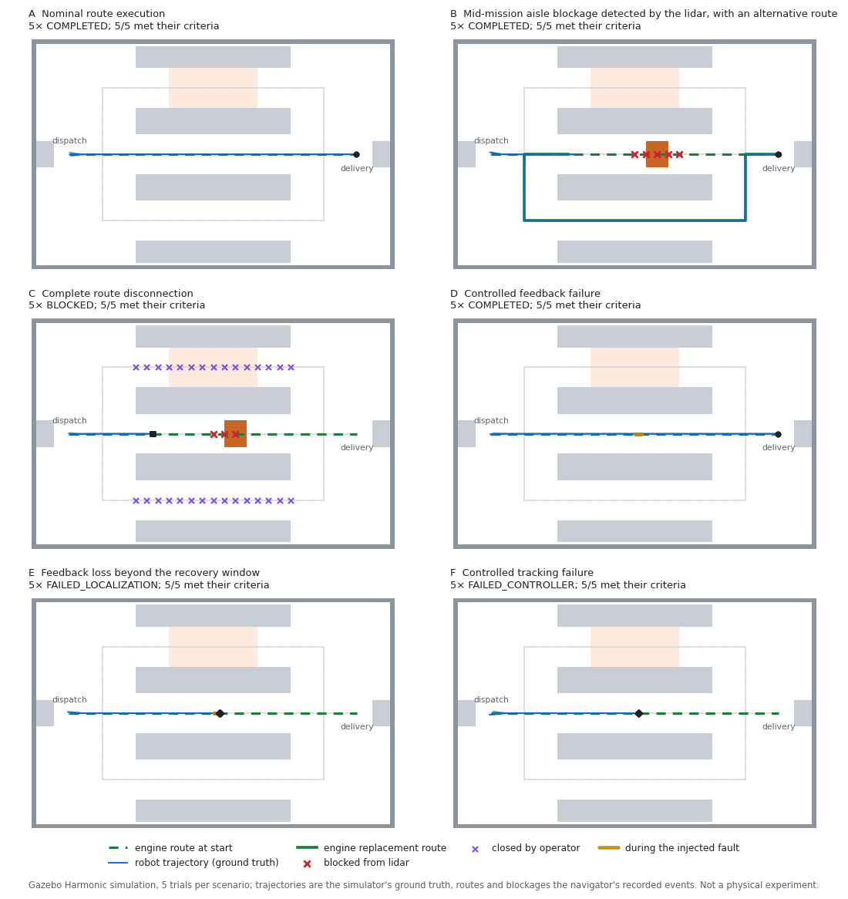

# ROS 2 and Gazebo integration

This folder runs the repository's planner inside a robotics stack: a simulated differential-drive
robot in a Gazebo warehouse, driven through ROS 2 by an adapter whose every route comes from the
engine's `NavigationCore`. Everything here is **simulation**. No physical robot was used, and nothing
here was executed on a robot's onboard computer: the simulator, the ROS 2 nodes and the planner all run
on one laptop in one container per trial.

**Results:** [`evidence/SUMMARY.md`](evidence/SUMMARY.md) (tables), [`evidence/summary.json`](evidence/summary.json)
(every metric), [`evidence/trials/`](evidence/trials) (one folder per attempted trial).

- [Execution chain](#execution-chain)
- [Stack and versions](#stack-and-versions)
- [Responsibilities](#responsibilities)
- [Adapter contracts](#adapter-contracts)
- [Robot model](#robot-model)
- [Warehouse world and roadmap](#warehouse-world-and-roadmap)
- [RViz2 view](#rviz2-view)
- [Scenarios and acceptance criteria](#scenarios-and-acceptance-criteria)
- [Results](#results)
- [Metrics](#metrics)
- [Clocks](#clocks)
- [Tests and checks](#tests-and-checks)
- [Reproduce](#reproduce)
- [Boundaries](#boundaries)

## Execution chain

<picture>
  <source media="(prefers-color-scheme: dark)" srcset="evidence/media/software-chain-dark.png">
  
</picture>

```text
scenario file ─► scenario_runner ─► ane/start_mission ─► graph_navigator ─► NavigationCore (A* via DynamicReplanner)
                     │                                        │  route = node sequence
                     │ scripted events                        ▼
                     │  spawn_obstacle (gz service)      MissionExecutive: leg tracking (SegmentController),
                     │  close_region (ane/blockage_reports)   node stepping (executeNavigationStep),
                     │  faults (ane/inject_fault)           blockages (handleObstacles), watchdogs
                     ▼                                        │ cmd_vel_nav (Twist)
                  Gazebo ◄── DiffDrive ◄── cmd_vel_robot ◄── fault_injector ◄── cmd_vel ◄── cmd_vel_gate
                     │
                     ├─ OdometryPublisher (ground truth) ─► /ground_truth/odom ─► fault_injector ─► /odom ─► graph_navigator
                     └─ gpu_lidar ─► /scan ─► graph_navigator: unexplained returns ─► blocked nodes ─► NavigationCore
```

1. The **scenario runner** (`ane_sim/scripts/scenario_runner.py`) waits for the simulation and requests a
   mission to a station.
2. The **graph navigator** (`ane_navigation/src/graph_navigator_node.cpp`) associates the robot's pose
   with the nearest roadmap node and calls `NavigationCore::startNavigation`; the engine's A* returns
   the node route.
3. The **mission executive** (`ane_navigation/core/src/mission_executive.cpp`, ROS-independent) drives the
   route leg by leg through the **segment controller** and calls `NavigationCore::executeNavigationStep`
   each time the robot reaches the next node.
4. Commands pass the **command gate** (stop mechanism) and the **fault injector** (test instrument,
   transparent unless a fault is requested) to Gazebo's **DiffDrive** system.
5. Gazebo's **OdometryPublisher** returns the robot's simulated ground-truth pose, which closes the loop;
   the **lidar** scan is mapped onto roadmap nodes, and newly blocked nodes go to
   `NavigationCore::handleObstacles`, which keeps the route, replaces the route ahead, or enters
   `BLOCKED`.

## Stack and versions

| Component | Version | Notes |
|---|---|---|
| ROS 2 | Jazzy Jalisco | `ros:jazzy-ros-base` image, linux/amd64 digest `sha256:c26c86a2…` (Docker Hub, 2026-10-27) |
| OS in the image | Ubuntu 24.04.5 LTS | |
| Gazebo | Sim 8.15.0 (Harmonic), SDFormat 14.9.0 | ROS vendor packages from packages.ros.org |
| ros_gz | 1.0.24 | bridge, `create`, launch |
| RViz2 | 14.1.24 | |
| rclcpp | 28.1.22 | |
| rosbag2 | 0.26.11, MCAP storage | |
| xacro, robot_state_publisher | 2.1.1, 3.3.4 | |
| Rendering | Mesa 25.2.8, llvmpipe (software OpenGL 4.5) | headless EGL for the lidar; Xvfb for recorded runs |
| Compiler | GCC 13.3.0, CMake 3.28.3 | in the image; the adapter core also builds with MSVC 19.51 |

The exact package list of the image is in `/opt/ane/versions.txt` inside it and in each campaign's
`campaign.json`.

**Why this combination.** The Gazebo documentation lists ROS 2 Jazzy with Gazebo Harmonic as the
recommended pair for Jazzy (it calls Ubuntu 24.04 + Jazzy + Harmonic the previous LTS combination; the
current one, ROS 2 Lyrical with Gazebo Jetty, targets Ubuntu 26.04), and gives Harmonic's end of life as
May 2029 ([installation](https://gazebosim.org/docs/latest/ros_installation/),
[releases](https://gazebosim.org/docs/latest/releases/)). This laptop's WSL distribution is Ubuntu
24.04, so Jazzy with Harmonic works both in the container and natively. Isaac Sim was not considered
further: its documented minimum GPU is an RTX 4080 with 16 GB
([requirements](https://docs.isaacsim.omniverse.nvidia.com/latest/installation/requirements.html)), and
this laptop has an RTX 1000 Ada with 6 GB; for a 2-D graph-planning experiment Gazebo's fidelity is
sufficient.

## Responsibilities

| Function | Done by | Not done |
|---|---|---|
| Route planning and replanning on the roadmap | **This engine**: `NavigationCore` (state machine, route ownership) with `DynamicReplanner` and `AStar` | |
| Pose-to-node association, leg tracking, node stepping, sensor-to-node blockage mapping, feedback/progress/tracking watchdogs | **Adapter core** (`ane_navigation/core`, ROS-independent C++) | |
| Message conversion, static transforms, visualisation markers | **Adapter node** (`graph_navigator`) | |
| Stop and stale-command guard | **Adapter** (`cmd_vel_gate`) | not a safety-rated stop |
| Physics, contacts, wheel actuation, lidar simulation, ground-truth pose | **Gazebo** (DART physics, DiffDrive, gpu_lidar, OdometryPublisher) | |
| Transport, TF, recording, visualisation | **ROS 2** (rclcpp, tf2, robot_state_publisher, rosbag2), **RViz2** | |
| Localisation, costmaps, local obstacle avoidance, recovery behaviours | — | **Nav2 is not used.** There is no AMCL or SLAM (pose is ground truth), no costmap, no local planner that leaves the roadmap, and no recovery behaviour beyond the halts below |

The engine's output is a node sequence. The only motion that is not on the engine's route is the
controller's tracking error, which is measured against the roadmap
([metrics](#metrics)) and bounded by the controller-failure rule, and the *return to the current node*
after a replacement (on the edge the robot was already driving, see below). Both are recorded.

## Adapter contracts

**Coordinate conversion.** The engine stores roadmap node coordinates in graph units (decimetres from
the hall's south-west corner); the map frame is metric and coincides with the Gazebo world frame:
`map = R(yaw) · (scale · graph) + origin` with `scale = 0.1`, `yaw = 0`, `origin = (-8, -5)`
(`GraphFrame`, `ane_core/roadmap.hpp`; tested both ways, including a non-zero yaw). Edge weights are
metres times a cost multiplier, so they do not depend on the graph units.

**Graph construction and edge costs.** `ane_sim/maps/warehouse_layout.txt` is the single source of the
geometry. `scripts/generate_world.py` writes both the Gazebo world and the roadmap from it: lane centre
lines are split at their end points and crossings and divided into pieces of at most 0.5 m. The roadmap
has 89 nodes and 90 two-way edges. An edge's weight is its length times the multiplier of the cost zone
containing its midpoint: the north aisle crosses a picking zone with multiplier 1.5, so the south aisle
(cost 19) is the cheaper detour although both detours are 19 m long. A test fails when the committed
world or roadmap no longer matches the layout.

**Start and goal association.** A mission starts from the robot's current pose: the start node is the
nearest node within 0.20 m (`association_radius_m`), otherwise the request is rejected with the
distance. Goals are station names (`dispatch`, `delivery`) or node ids.

**Pose feedback and arrival.** The navigator's only pose input is `odom`; in the trials it is the
simulator's ground truth (below), relayed by the fault injector. The map → odom transform is read once
from TF and must be static. A node the route passes straight through counts as reached when the
robot's projection on the leg passes it. A *stop point* (a node where the route turns by more than 10°,
or the goal) counts as reached within 0.06 m, or once passed with the cross-track error inside
0.20 m. The goal counts as reached within 0.10 m (`goal_tolerance_m`), after which the robot brakes to a
standstill and the mission is `COMPLETED`. Each reached node is one `NavigationCore::executeNavigationStep`.

**Route execution.** The segment controller (`ane_core/segment_controller.hpp`) turns in place when the
heading error to the leg exceeds 0.30 rad (braking first if moving) and otherwise drives pure pursuit
along the leg's line with a 0.40 m look-ahead, with the speed planned to stop at the next stop point
(`v ≤ √(2·a·d)`). The robot therefore drives along edges and turns only on nodes; it does not cut
corners between edges. Limits: 0.5 m/s, 1.0 rad/s, 0.5 m/s² (speeding up and planned slowing), 1.0 m/s²
(braking), 2.0 rad/s². A property test checks that 20,000 random control steps respect every bound.

**Footprint, turning and clearance.** A collision-free edge is not enough: the robot sweeps its
footprint along the edge with some tracking error, and turns in place on nodes. The footprint is
0.40 m × 0.37 m (chassis length × outer wheel faces), circumscribed radius 0.272 m. At start-up the
navigator checks the roadmap against the static map and refuses to run if any node has less than
0.272 + 0.10 = 0.372 m clearance (turning in place) or any edge less than 0.272 + 0.20 + 0.10 = 0.572 m
(driving with the largest tracking error the controller tolerates). The warehouse roadmap has at least
0.70 m everywhere.

**Blockage-to-graph mapping.** *Sensor-derived:* each scan is placed with the newest pose (within 0.1 s
of the scan) and the static lidar mount; returns farther than 0.10 m from every static obstacle and
wall are *unexplained*. A node is blocked when at least 3 unexplained returns lie within 0.55 m of it in
2 consecutive scans. Nodes are 0.5 m apart, so any return inside the corridor the robot may sweep along
an edge (0.272 m radius + 0.20 m tracking error) lies within √(0.25² + 0.472²) = 0.534 m < 0.55 m of an
end node of that edge (also checked by a test on every edge). *Operator or scripted:* an
`ane/blockage_reports` message with source `OPERATOR` or `SCRIPTED` closes the listed nodes and every
node inside an optional rectangle; a report claiming source `SENSOR` is rejected. Every blocked node
keeps the source that reported it first, and blockages stay until cleared; nothing clears them
automatically.

**Replanning and route replacement.** Newly blocked nodes go to `NavigationCore::handleObstacles`. The
engine keeps the route when it is clear, replaces the part ahead from the current node otherwise, or
enters `BLOCKED` when no route is left (the engine exempts the robot's own node from removal). The
executive never edits a route; what it drives is always `NavigationCore::getCurrentPath()`. When the
replacement's next node differs from the one the robot was heading to and the robot is more than
0.15 m past the current node, it first drives back to that node along the edge it was on, then follows
the new route.

**No route, controller failure, localisation failure.** Every terminal state commands zero velocity on
every later control period.
- `BLOCKED`: the engine found no route; the engine's state is `BLOCKED`, its invalidated route is
  published on `ane/invalidated_route`.
- `HOLDING_FEEDBACK` → `FAILED_LOCALIZATION`: the newest pose is older than 0.25 s: zero velocity, engine
  paused (`pauseNavigation`). Fresh feedback within 4.0 s resumes if the pose is still within 0.20 m of
  the leg; otherwise, or after 4.0 s, `FAILED_LOCALIZATION`.
- `FAILED_CONTROLLER`: no progress (0.05 m, or 0.05 rad when turning) for 4.0 s while motion is
  commanded, or a cross-track error above 0.20 m while driving.

**Stop mechanism and stale commands.** `cmd_vel_gate` forwards `cmd_vel_nav` to `cmd_vel` at 20 Hz on the
steady clock and sends zero instead while `ane/estop` (latched `std_msgs/Bool`) is set or when the
newest command is older than 0.3 s. It uses no simulator service and no simulation time, so it also
stops the base when the navigator or simulation time stalls. Gazebo's DiffDrive keeps executing the last
command it received and documents no timeout, so the gate publishes zero actively. The navigator also
has an `ane/stop` service (latched `STOPPED`). Stale *feedback* is handled by the navigator (zero
velocity after 0.25 s, above).

**Localisation.** The pose the navigator uses is **simulator ground truth**: Gazebo's OdometryPublisher
system publishes the model's pose from the simulation state at 50 Hz. It is not SLAM, AMCL or wheel
odometry. DiffDrive's wheel odometry is recorded on `/wheel_odom` for comparison and never used.

## Robot model

`ane_description/urdf/ane_amr.urdf.xacro` (frames follow REP 103 and REP 105):

```text
map ─(static, identity)─ odom ─(ground truth, 50 Hz)─ base_footprint ─(fixed, z 0.06)─ base_link
    base_link ─ left_wheel_link, right_wheel_link   continuous about +y at y = ±0.17 m
    base_link ─ front_caster_link, rear_caster_link fixed spheres at x = ±0.15 m
    base_link ─ lidar_link                          fixed, scan plane 0.18 m above the floor
```

| Part | Geometry | Mass | Inertia (kg·m², about the centre of mass) |
|---|---|---|---|
| Chassis | box 0.40 × 0.30 × 0.12 m, 0.04 m above the floor | 8.0 kg | Ixx 0.0696, Iyy 0.1163, Izz 0.1667 |
| Wheels (2) | cylinders r 0.06 m, width 0.03 m, separation 0.34 m | 0.4 kg | Iyy 7.2·10⁻⁴ (axle), Ixx = Izz 3.9·10⁻⁴ |
| Casters (2) | spheres r 0.0195 m, frictionless | 0.1 kg | 1.5·10⁻⁵ |
| Lidar | cylinder r 0.035 m, h 0.04 m | 0.15 kg | Ixx = Iyy 6.6·10⁻⁵, Izz 9.2·10⁻⁵ |

Inertias come from the solid-body formulas in `inertia.xacro`; `check_urdf` validates the expanded
model in the package tests. Gazebo plugins: DiffDrive (base limits 0.6 m/s, 1.5 rad/s, 1.0 m/s²,
3.0 rad/s²; the navigator's own limits are lower), OdometryPublisher (ground truth), JointStatePublisher
(wheel joints for TF). The only sensor is the 2-D lidar: 360 beams over 360°, 0.12–10 m, 10 Hz, Gaussian
range noise σ = 0.01 m, seeded per trial through `gz sim --seed`.

## Warehouse world and roadmap

A 16 m × 10 m hall (map frame x ∈ [−8, 8], y ∈ [−5, 5]) with two middle rack rows and two wall rack rows
forming three east–west aisles (centre lines y = 3, 0, −3; 1.8 m wide), cross aisles at x = ±5, a
dispatch station at (−6.5, 0) and a delivery station at (6.5, 0), each in front of a table or conveyor.
Racks are solid up to 0.5 m in the visual model so that the lidar, which renders visual geometry, sees
the same closed faces as the static map. Floor markings show the lanes, the stations and the picking
zone; they have no collision geometry.

## RViz2 view

`ane_sim/config/ane.rviz`, fixed frame `map`, top-down. RViz2 shows ROS data; Gazebo simulates the robot
and the world. The view frames the whole hall at 44 px/m; the grid and TF axes are off, and line widths
and marker sizes are chosen so that the recordings, which show this view at about a third of a screen
width, stay legible.

| Display | Topic | Shows |
|---|---|---|
| Roadmap, static map, cost zone, stations | `ane/graph_markers` (latched) | the roadmap the engine plans on, the static obstacles the blockage mapper knows, the picking zone |
| Blocked nodes | `ane/blocked_markers` (latched) | red: blocked from the lidar (`SENSOR`); purple: closed by an operator |
| Engine route | `ane/planned_route` (latched) | `NavigationCore::getCurrentPath()`, travelled part included |
| Invalidated route | `ane/invalidated_route` (latched) | `NavigationCore::getInvalidatedRoute()`, non-empty only in `BLOCKED` |
| Observed trajectory | `ane/observed_trajectory` | simulator ground truth (`trajectory_path`), every 2 cm |
| Target node, unexplained returns | `ane/live_markers` | the node being driven to; lidar returns the static map does not explain |
| Lidar scan, robot model, TF | `scan`, `robot_description`, `tf` | `map`, `base_footprint`, `lidar_link` axes |

## Scenarios and acceptance criteria

The scenario files (`ane_sim/scenarios/*.txt`) define the events, seeds, initial-pose jitter and
acceptance criteria. The criteria were written before the first trial ran, and every trial manifest
records the SHA-256 of its scenario file. Initial poses are jittered uniformly by ±0.10 m in x and y and
±0.20 rad in yaw around the dispatch station (seeded by `seed + trial`).

| | Scenario | Event | Expected outcome |
|---|---|---|---|
| A | Nominal route execution | none | `COMPLETED` via the middle aisle |
| B | Mid-mission aisle blockage | once the robot is in the middle aisle (x ≥ −3), a 1.0 × 1.2 × 1.0 m pallet is created at (1, 0); the navigator only sees it with the lidar | blockage detected from the lidar, route replaced by the engine, `COMPLETED` via the south aisle |
| C | Complete route disconnection | at the start an operator closes the north and south aisles (`OPERATOR` reports); then the pallet appears in the middle aisle | `BLOCKED`, controlled halt |
| D | Feedback failure, recoverable | at x ≥ 0 the fault injector withholds pose feedback for 2.0 s | hold with zero velocity, recovery, `COMPLETED` |
| E | Feedback loss | as D for 6.0 s, longer than the 4.0 s recovery window | `FAILED_LOCALIZATION`, robot stopped |
| F | Tracking failure | at x ≥ 0 the fault injector replaces drive commands with zero for 8.0 s | `FAILED_CONTROLLER` from the progress watchdog |

Criteria per scenario are listed in each file (`accept <metric> <op> <value>`); the summary reports how
many trials met each one.

**Detected versus scripted blockages.** A spawned obstacle is a scripted *world* event: the runner
creates a model in Gazebo and tells the navigator nothing; the blockage the navigator reports is
`SENSOR`-sourced and comes from its lidar. An operator closure is a scripted *notification*: an
`OPERATOR`-sourced report on `ane/blockage_reports`, with no physical obstacle. Both are recorded with
their sources (`ane/events`, `ane/scenario_events`).

## Results

**Evaluation campaign `2026-11-09-eval`** (engine commit `fbe3278`, which contains this integration
code; `campaign.json` records the integration-tree hash): 30 trials attempted, 30 met every acceptance
criterion and passed every consistency check. Full tables: [`evidence/SUMMARY.md`](evidence/SUMMARY.md).

| Scenario | Outcome | Measurements (min–max over 5 trials) |
|---|---|---|
| A | `COMPLETED` ×5 | final error 0.044–0.051 m; mission 26.8–28.1 s |
| B | `COMPLETED` ×5 | lidar blockage 0.130–0.223 s after the pallet appeared, always the same 5 nodes; 1 route replacement each, engine call 0.119–0.219 ms (host); final error 0.016–0.052 m; mission 66.5–68.3 s |
| C | `BLOCKED` ×5 | 2 operator closures, then the lidar blockage 0.169–0.220 s after the pallet appeared; engine call that found no route 0.127–0.387 ms (host); stopped 0.53–0.57 s after `BLOCKED`, no drift |
| D | `COMPLETED` ×5 | hold 0.249–0.300 s after the feedback stopped; 0.255–0.280 m travelled without feedback; final error 0.045–0.053 m |
| E | `FAILED_LOCALIZATION` ×5 | hold 0.249–0.298 s after the feedback stopped; 0.246–0.276 m travelled without feedback; no drift after the stop |
| F | `FAILED_CONTROLLER` ×5 | failure declared 4.35–4.40 s after the stall began; no drift after the stop |

Across all 30 trials: no collision, smallest footprint clearance 0.41 m, largest deviation from a
roadmap edge 0.121 m, no false blockage in the 20 trials without an obstacle, and every route the robot
followed reproduced offline by the engine (40 engine calls). The host was shared with other work; the
simulation ran at a real-time factor of 0.69–1.05 in host time, which changes wall-clock values but not
behaviour, which runs in simulation time.



**Recorded runs `2026-11-09-capture`**: one trial each of scenarios B and C, with the Gazebo GUI and
RViz2 rendered in software on a virtual display; they are the source of the README's animations and are
not part of the evaluation. B completed 0.050 m from the goal, with the lidar blockage 0.225 s after the
pallet appeared and a route replacement of 0.125 ms (container clock); C reached `BLOCKED` and stood
still 0.58 s later. Rendering slowed the simulation to a real-time factor of 0.74 and 0.82 in host time.
Each trial folder also holds `camera_log.csv`, every move of the GUI camera
(`tools/capture_camera.py`: it follows the robot along its lane in the world frame, and shows an
overview of the middle and south aisles after the engine replaces the route or finds none). The media in
[`evidence/media`](evidence/media) are drawn by `tools/make_video.py` from the screen frames and the
trial's recorded data; each has a provenance record (`.json`) listing the trial, the engine commit, the
integration-tree hash, the image, the hashes of the trial files and the playback speeds.

**Earlier campaigns** `2026-11-08`, `2026-11-08-eval` and `2026-11-08-capture` ran on an earlier,
uncommitted revision of this integration with the same navigation code (the recording and visualisation
code and the world's materials changed afterwards); 30 of 30 met every criterion in both 30-trial
campaigns. They are kept as recorded ([`evidence/README.md`](evidence/README.md)).

**Recordings.** The rosbag2 files of these campaigns (307 MB in 15 archives, MCAP with zstd) are not in
Git and have not been published. [`evidence/recordings.json`](evidence/recordings.json) lists each
archive and each bag with its size and SHA-256, so that a later upload can be checked against them.

## Metrics

All metrics come from the trial's rosbag2 recording and the scenario runner's record
(`ane_sim/scripts/analyze_trial.py`). Robot motion always comes from the simulator's ground truth
(`/ground_truth/odom`), never from the navigator. Times are simulation seconds unless marked wall.

| Metric | Definition |
|---|---|
| `outcome` | the navigator's final mission state |
| `goal_reached`, `final_position_error_m` | ground-truth distance from the robot to the goal node at the end of the recording; reached if ≤ 0.10 m |
| `collisions`, `min_clearance_m` | exact distance between the footprint rectangle at each ground-truth pose (50 Hz) and every obstacle rectangle (static map, and each spawned obstacle from the moment its creation was confirmed); a collision is an interval with distance 0 |
| `max_cross_track_m`, `rms_cross_track_m` | distance from the ground-truth position to the nearest roadmap edge centre line, over the samples where the mission is executing |
| `waypoint_progress` | fraction of the final route's steps completed |
| `interventions` | commands not defined by the scenario: emergency stops, stop or retry requests, blockage reports beyond the scenario's closures |
| `sensor_blockage_reports`, `operator_blockage_reports` | blockage reports by source |
| `detection_latency_s` | first `SENSOR` report minus the confirmed creation of the obstacle |
| `replans`, `engine_call_ms` | route replacements, and the wall-clock duration of each engine call (`startNavigation`, `handleObstacles`) measured with a steady clock inside the executive |
| `blocked_nodes_entered` | nodes reached after they were reported blocked |
| `route_matches_engine` | every route the navigator published equals the route `ane_route_check` plans offline from the same node with the same blocked nodes (NavigationCore, same code), and every `BLOCKED` has no offline route either |
| `stop_time_after_terminal_s`, `drift_after_stop_m` | time from the terminal state until the robot stays below 0.01 m/s and 0.01 rad/s for the rest of the recording, and the largest displacement after that |
| `hold_detect_s`, `blind_travel_m`, `failure_detect_s` | fault start to `FEEDBACK_STALE`, distance travelled from the fault start until standstill, and fault start to `FAILED_CONTROLLER` |
| `path_length_m`, `executed_graph_cost` | ground-truth path length from the mission request to the terminal state, and the edge-weight sum along the nodes the robot reached |
| `mission_time_s`, `mission_wall_s`, `real_time_factor` | mission request to terminal state in simulation time and in the container's monotonic time, and their ratio |

Each trial also passes **consistency checks**: the navigator's outcome equals the runner's; its
reported final error matches the ground truth within 0.02 m; the reached nodes form a walk on the roadmap
equal to the start of the final route; every published route is an engine route; every command is
within the controller limits.

## Clocks

Behaviour runs on simulation time: the navigator, fault injector and scenario runner use the node
clock, which follows Gazebo's `/clock`. Two wall clocks appear in the evidence, with known defects of
the Docker Desktop VM the trials run in:

- **System clock.** The VM's time synchronisation steps it back by about 1.3 s roughly every 30 s. Bags
  are therefore recorded with simulation-time receive stamps (`ros2 bag record --use-sim-time`); with
  wall-clock stamps the bag reader, which orders by stamp, interleaves messages from before and after
  each step. Event messages carry a sequence number for the same reason.
- **Monotonic clock.** Continuous, but faster than the host's: each campaign's `campaign.json` records
  the measured rate (`clock_check_before` / `clock_check_after`; 1.0487 and 1.0496 container seconds
  per host second in the evaluation campaign). Wall-clock durations (`mission_wall_s`, `engine_call_ms`)
  are measured with it and stored uncorrected per trial; the summary divides them by the mean rate and
  marks the results *host*. Gazebo paces itself on the same clock, so a real-time factor of 1.0 on that
  clock is about 1.05 in host time.
- **Screen frames of recorded runs** are stamped with the monotonic clock as they are grabbed
  (`tools/capture_frames.py`), and `capture_clock.csv` maps that clock to simulation time, so the
  recordings stay in step with the simulation however many frames a busy host skips. (ffmpeg's screen
  grabber, used before, stamps frames with the stepped system clock and was read as a constant 10 frames
  per second, which a loaded host does not deliver.)

## Tests and checks

| Check | Needs | Where |
|---|---|---|
| Adapter-core unit tests (17 cases): graph frame, roadmap parsing and errors, clearance contract, node-blocking coverage, false-positive scan of the static warehouse from every node, pallet detection, controller bounds (20,000 random steps), turn-in-place, executive transitions (start, hold, recovery, loss, keep/replace/`BLOCKED`, rejoin, stop) | C++17 compiler only | `core/test/test_adapter_core.cpp` |
| Closed-loop kinematic test: all six scenarios with all their seeds against an ideal unicycle and a ray-cast lidar (no physics, noise or latency; a logic test, not a simulation result) | C++17 compiler only | `core/test/test_closed_loop.cpp` |
| URDF validity (`xacro` + `check_urdf`), world/roadmap up to date, world valid SDFormat (`gz sdf -k`) | ROS 2, Gazebo | `colcon test` |
| Simulation trials with acceptance criteria and consistency checks | the ane-sim image | `tools/run_trials.py` |

## Reproduce

From the repository root, with Docker:

```bash
docker build -t ane-sim:jazzy ros2/docker
```

```bash
docker run --rm -v "$PWD:/ane" -v ane-ws:/ws ane-sim:jazzy bash /ane/ros2/tools/container_build.sh --test
```

```bash
python ros2/tools/run_trials.py --campaign my-campaign
```

```bash
python ros2/tools/summarize_trials.py --campaign my-campaign
```

Recorded runs (Gazebo GUI and RViz2 on a virtual display), then the media and the figures:

```bash
python ros2/tools/run_trials.py --campaign my-capture --scenarios B_aisle_blockage C_disconnection --trials 1 --capture
```

```bash
docker run --rm -v "$PWD:/ane" ane-sim:jazzy python3 /ane/ros2/tools/make_video.py --story mission --capture-dir /ane/build/ros2-trials/my-capture/B_aisle_blockage/trial_0 --trial-dir /ane/ros2/evidence/trials/my-capture/B_aisle_blockage/trial_0 --out-dir /ane/build/my-media
```

```bash
docker run --rm -v "$PWD:/ane" ane-sim:jazzy python3 /ane/ros2/tools/make_video.py --story failure --capture-dir /ane/build/ros2-trials/my-capture/C_disconnection/trial_0 --trial-dir /ane/ros2/evidence/trials/my-capture/C_disconnection/trial_0 --out-dir /ane/build/my-media
```

```bash
docker run --rm -v "$PWD:/ane" ane-sim:jazzy python3 /ane/ros2/tools/render_figures.py --campaign-dir /ane/ros2/evidence/trials/my-campaign --out /ane/build/my-figures
```

```bash
python ros2/tools/render_chain.py --out-dir build/my-media
```

Check the published evidence (replays every recorded engine call through this checkout's engine):

```bash
python ros2/tools/check_sim_evidence.py --route-check build/adapter-core/ane_route_check
```

The adapter core and its tests also build without ROS:

```bash
cmake -S ros2/ane_navigation/core -B build/adapter-core && cmake --build build/adapter-core && ctest --test-dir build/adapter-core
```

Interactive run with the Gazebo GUI and RViz2 (needs a display, for example WSLg):

```bash
ros2 launch ane_sim sim.launch.py gui:=true rviz:=true
```

## Boundaries

- **Simulation, not deployment.** Every result is from Gazebo. Nothing has run on a physical robot, and
  nothing was executed onboard: the planner, the adapter and the simulator share one host.
- **Ground-truth localisation.** The navigator receives the simulator's pose. Localisation error,
  drift and relocalisation are untested; the feedback-failure scenarios test only missing feedback.
- **Known static map.** The blockage mapper assumes the static map is exact and every obstacle is a box
  taller than the scan plane; it latches blockages and never clears them; it has no notion of moving
  obstacles or people.
- **Minimal motion layer.** One robot, a rotate-then-drive pure-pursuit controller, Gazebo's ideal
  velocity-controlled DiffDrive, flat floor. No Nav2, no costmaps, no local avoidance, no recovery
  behaviours.
- **Not a safety system.** The gate and the halts are integration mechanisms, not safety functions; they
  are not certified or rated.
- **Few trials.** Five trials per scenario, with seeded initial poses and sensor noise, characterise
  these six scenarios in this world, not navigation performance in general.
